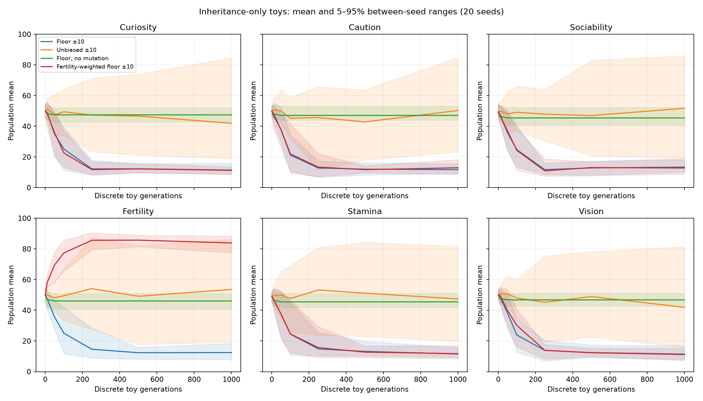

# Inheritance: results and limits

Performance gate: commit `787edef`; 315 fast tests passed before scientific trials.
The protocol and source audit were committed before executing these trials.
Production biology and inheritance are unchanged.

## Isolated arithmetic: selection is not necessary for a decline

Twenty independent seeds, 60 individuals, six traits, 1,000 discrete generations.
No ecology or survival in these mathematical populations. Each row below is the
mean of 20 seed-level final population means. The complete seed trajectories,
minima/maxima, paired intervals and arithmetic terms are in `evidence/`.

| Condition | Curiosity | Caution | Sociability | Fertility | Stamina | Vision |
|---|---:|---:|---:|---:|---:|---:|
| Production floor, ±10 mutation |11.46|11.72|13.41|12.46|11.53|11.45|
| Unbiased stochastic rounding, ±10 |41.96|50.29|51.74|53.60|47.45|41.95|
| Floor, no mutation |47.45|47.10|45.45|46.10|45.50|46.80|
| Unbiased, no mutation |50.95|50.60|48.70|49.50|48.95|50.25|
| Floor, ±5 mutation |4.66|4.81|5.20|5.24|4.82|4.75|
| Fertility-weighted parent pairs, floor ±10 |11.27|12.97|12.81|83.92|11.74|11.17|

Paired production-floor minus unbiased rounding differences at generation 1,000:

| Trait | Difference | Bootstrap 95% interval, n=20 matched seeds |
|---|---:|---:|
| Curiosity |-30.50|[-38.49,-23.17]|
| Caution |-38.56|[-47.87,-28.99]|
| Sociability |-38.33|[-47.91,-29.18]|
| Fertility |-41.14|[-50.95,-31.24]|
| Stamina |-35.93|[-45.22,-26.71]|
| Vision |-30.50|[-39.71,-21.31]|

The source formula loses 0.5 on odd parent sums. In the floor±10 trials the measured
average rounding increment was-0.2480 per child trait; mutation averaged+0.0012
and bounds contributed+0.2115. These are distinct terms, not all “selection.”
Unbiased±10 rounding averaged+0.000135; mutation+0.001198; bounds-0.000506.
The ±10 mutation uniforms were matched across all applicable conditions.

With no mutation, floor bias reduced means by only a few points before populations
homogenized. Mutation continually reintroduces odd sums; averaging, rounding and
bounds then interact. Less mutation did **not** rescue low values: ±5 floor trials
ended still lower. This is an experimental result under the declared discrete
generation toy, not a proposed production balance change.

Fertility weighting uses exactly the production pair probability numerator,
`(fertility_a+fertility_b)//3`, but assumes well-mixed, distinct parent pairs and
fixed population replacement. It lifts fertility strongly while leaving other
traits low. This establishes a causal reproductive weighting effect in the toy.
It does not estimate spatial reproduction or survival selection in the real game.

## What this changes about the original playtest interpretation

Values around 13–14 can emerge from the inheritance arithmetic alone. The real
world's declining caution/curiosity/sociability/vision therefore **cannot simply
be attributed to ecological selection**. Fertility's rise is consistent with a
real production probability advantage, but this experiment does not show how much
of its observed 70.50 comes from that advantage versus ecology/covariance/history.
Stamina has an explicit survival-age connection; its historical 54.66 is not
explained by the neutral toy or proven adaptive by the snapshot.

The unbiased condition has substantial between-seed drift at N=60; its finite
sample means need not equal 50. Confidence intervals concern differences between
these toy conditions. The plot uses between-seed 5–95% ranges, not confidence bands
for individual gnomes. Toy generations are not simulation ticks, and do not map
directly onto the player's overlapping generations or population≈376.

The unchanged six-world ecology results and actual birth arithmetic follow below. No historical mutation samples
or missing decision traces are reconstructed from the real player's archive.

## Unchanged ecology: six seeds at 10,000 ticks

| Trait | Founder mean across six worlds | Living mean | Mean change | Range of living means |
|---|---:|---:|---:|---:|
| Curiosity |48.93|48.35|-0.57|42.41–50.66|
| Caution |49.80|48.27|-1.53|44.34–50.77|
| Sociability |48.43|46.45|-1.98|42.14–51.34|
| Fertility |50.60|54.53|+3.93|51.42–57.30|
| Stamina |49.90|51.83|+1.93|47.01–55.78|
| Vision |50.82|48.23|-2.60|46.01–50.95|

These are equal-weighted world means, not a pooled individual-level significance
test. Final populations 359–381; maximum ancestry depth 23–25. This is much shorter
than the historical 428k world and the 1,000-generation toy. The finite-window
cohort changes do not isolate survival selection from birth and age composition.

Across 11,537 actual descendant births, each trait's mean floor-rounding loss was
approximately 0.248–0.251. Child minus floored parent average combines the unknown
original mutation sample with any clamping; it cannot reveal a lost mutation roll.
That residual averaged-0.0007..+0.1193 across the six trait dimensions. The exact
aggregate parent/child/rounding terms are in each ecology JSON.

Fertility and stamina increased on average in these ordinary worlds. That is
consistent with their explicit probability/age effects but is not an isolated
causal estimate. No production inheritance, survival, scheduling or trait values
were changed. The same seed-1 10k trajectory matched an uninstrumented full replay.
The complete mathematical CSV set also reproduced byte-for-byte in a second run.

## Recommendation

Treat the downward inheritance bias as a measured property of the accepted model,
not as evidence that low curiosity/caution/vision was necessarily favored.
Any decision to change rounding belongs to a separately authorized behavior
experiment with the verified rule retained as control. Quantifying historical
survival selection remains open. No balance or biology fix is included here.

