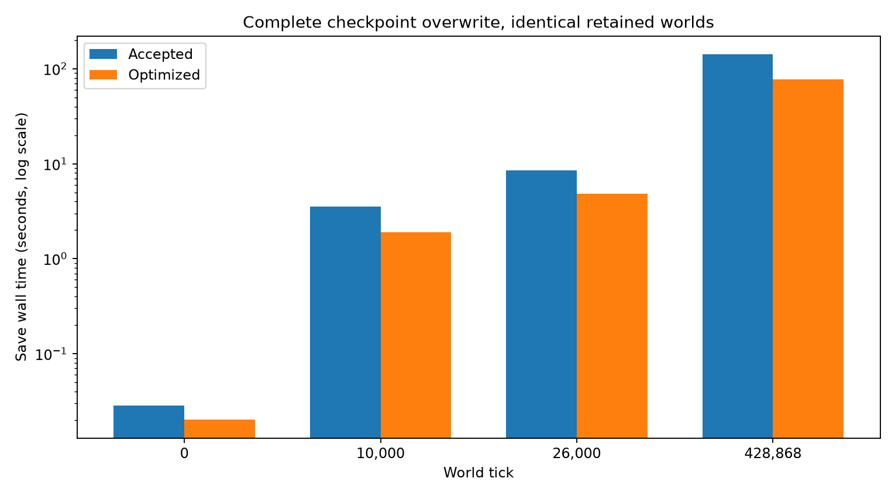

# Deep-time persistence results

Reference: `72a101727d84a65dd49186503eea765825fa0987`. Same seed-1 worlds; player-scale runs use only the independent private copy, with zero tick advancement. One measured trial per storage cell; these are measurements, not confidence intervals. Some independent regression/probe jobs ran concurrently on this 8-core host; CPU/elapsed phase values are retained in JSON. Do not read sub-millisecond differences as meaningful.

| World tick | Agents / events | Save before (s) | Save after (s) | Previous validation before / after (s) | Outgoing state+JSON before / after (s) | Peak RSS before / after (GiB) |
|---|---:|---:|---:|---:|---:|---:|
| 0 | 60 / 60 | 0.028 | 0.020 | 0.013 / 0.006 | 0.004 / 0.002 | 0.028 / 0.028 |
| 10,000 | 2,017 / 107,609 | 3.556 | 1.893 | 2.450 / 1.228 | 0.909 / 0.492 | 0.407 / 0.389 |
| 26,000 | 5,340 / 290,808 | 8.472 | 4.844 | 5.878 / 3.121 | 2.101 / 1.284 | 1.004 / 0.952 |
| 428,868 | 91,003 / 4,691,860 | 142.234 | 77.949 | 103.699 / 51.762 | 31.445 / 20.815 | 15.504 / 14.709 |

The JSON encoder alone becomes slower with the dataclass default handler; the combined state-materialization + encoding path becomes faster. Peak RSS covers loading plus saving in one process. It is not simultaneous owner+worker memory. Cold loading remains roughly 51–54 seconds at player scale because its strict reader is unchanged.

## Transaction details

| World tick | Acquire before / after (ms) | Payload update before / after (s) | Commit before / after (ms) | SQLite bytes |
|---|---:|---:|---:|---:|
| 0 | 0.013 / 0.013 | 0.000 / 0.000 | 0.012 / 0.011 | 102,400 |
| 10,000 | 0.015 / 0.014 | 0.022 / 0.026 | 0.020 / 0.025 | 19,640,320 |
| 26,000 | 0.012 / 0.015 | 0.061 / 0.063 | 0.023 / 0.023 | 52,801,536 |
| 428,868 | 0.016 / 0.015 | 1.052 / 1.223 | 0.040 / 0.030 | 1,779,752,960 |

SQLite update timings include work done before commit. All writes retain synchronous=FULL. The format and complete canonical logical state are unchanged. Nested parse/validation timings are inclusive and not additive.

## Actual launcher finalization, private 428,868-tick copy

| Metric | Accepted launcher | New launcher |
|---|---:|---:|
| Cold load (s) | 52.428 | 51.424 |
| Final save (s) | 146.688 | 78.213 |
| Post-commit summary (s) | 33.688 | 0.329 |
| Shutdown save + summary, no pending worker (s) | 180.376 | 78.542 |
| Whole zero-tick launch, load included (s) | 232.804 | 129.966 |

This executed the real `_launch` headless finalization at zero additional ticks under the private checkpoint’s ownership gate. It is not the earlier timestamp-based 4m26 playtest estimate. A pending worker must still drain before the final owner save; there was no pending worker in this measurement. Never add unrelated benchmark phases and call them a measured shutdown. The separate `checksum-probe.json` measures 0.446 s hashing 891,352,072 bytes in bounded chunks (plus 0.210 s SQLite blob reads); it is a component probe, not an exact writer subphase.

## Snapshot pauses: unchanged Chronicle, measured separately

| World tick | Cold full capture (ms) | Preparation total (s) | Worst preparation slice (ms) | Warm capture median / worst (ms) | Feeder pickle (s) |
|---|---:|---:|---:|---:|---:|
| 26,000 | 551.8 | 3.23 | 81.8 | 14.6 / 17.2 | 0.011 |
| 428,868 | 13568.8 | 58.33 | 1077.5 | 113.2 / 147.8 | 0.310 |

**Residual hitch is real.** Chronicle is unchanged: at player scale even warmed capture can exceed 100 ms. A completely unprepared fallback can take seconds; preparation budgets are soft; the root cause of the largest preparation outlier was not isolated. Allocation/GC is a hypothesis, not a measured attribution. Cold preparation was a tight-loop measurement, not a promise about wall time while playing. Cached bytes grow with retained history; they are not constant memory. No new caching, GC policy or history truncation is introduced to hide these limits.

## Real Pygame / Saveguard operational runs, generated 26,000-tick fixture

| Metric | Accepted writer | New writer |
|---|---:|---:|
| Snapshot capture (ms) | 24.384 | 22.239 |
| p95 frame gap (ms) | 27.051 | 26.813 |
| p99 frame gap (ms) | 31.867 | 31.706 |
| Worst frame gap (ms) | 147.064 | 140.997 |
| Background capture-to-completion (s) | 10.664 | 6.432 |
| Writer save (s) | 9.389 | 5.167 |
| Remaining pipeline/IPC/reconstruction/polling (s) | 1.274 | 1.265 |
| Final stopped-owner save (s) | 9.852 | 5.111 |

SDL dummy exercised the real renderer, input handling, follow, Decisions, Advisor, background writer, graceful exit and exact reload continuation. Human smoothness feedback is **pending**. No cosmetic/presentation code changed. The final tick differs because the faster writer completes earlier in a running world; compare equal tick 26,600 snapshots, not those final populations. Frame maxima include initialization/preparation and ordinary simulation, not only saving. Do not attribute every frame-gap difference to storage.

## Remaining engineering work

Full checkpoint writes remain O(retained history); the reader still parses and rehydrates one complete previous world, and JSON remains a complete document. This deliberately smaller optimization preserves all integrity checks. Further reductions need a separately tested streaming semantic validator or a proven validation-receipt protocol, and a profile-led Chronicle cold/warm preparation design. Replacing full files with auxiliary delta caches is not performed. Large-world final saves still require patience.

Reproduction commands are in `REPRODUCE.md`; all raw measurements are adjacent.

## Additional cold object-graph load probe

The strict reader is unchanged before/after. Fresh-process loads of the generated
0/10k/26k and private player checkpoints took 0.019/1.160/2.986/50.417 seconds.
At player scale JSON parsing took 11.853 s, reconstruction including validation
35.622 s, validation 1.241 s (nested, not additive). Peak load-only RSS 10.48 GiB.
OS cache state was uncontrolled; “cold” means no prepared World/Chronicle cache,
not a claim that the SSD/page cache was flushed. See `load-*.json` and
`research.deep_time.profile_load`.

Measurements ran on the Ryzen 7 3800X (8 cores/16 threads), Python 3.14.4,
SQLite 3.46.1. Exact library/platform versions are in `environment.json`.
No owner-process frame trace at 428k was collected: that scale has direct snapshot
and storage probes, while the actual Pygame frame trace uses the 26k fixture. We do
not certify giant-world smoothness from the smaller viewport test.

