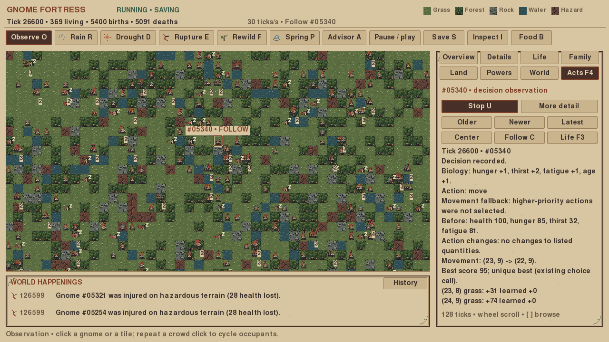

# Operation Deep Time — handoff

**Delivered:** a verified persistence optimization, measured remaining large-world
limits, and reproducible inheritance/starvation studies. **Not delivered:** a
claim that every 428k-world checkpoint pause has disappeared.

The real 428,868-tick artifact remains unchanged. No gameplay process was launched
against it. Destructive/performance work used one independent private copy and
fresh generated worlds. Its complete payload still hashes to
`865f2d2304e3e302650860c25ddbae88d06ecc80323da61f0414bce7682a2611`.
The rewritten private copy has that same actual payload hash, not just matching
metadata. Source size and modification time also remain unchanged.

## Engineering outcome

| 428,868-tick private copy | Accepted baseline | Optimized |
|---|---:|---:|
| Complete overwrite |142.23 s|77.95 s|
| Previous-world validation/reconstruction |103.70 s, twice|51.76 s, once|
| Outgoing state + JSON |31.45 s|20.81 s|
| Peak load/save process RSS |15.50 GiB|14.71 GiB|
| Actual launcher shutdown save + summary, no worker pending |180.38 s|78.54 s|

The old path reconstructed the complete previous world before writing and again
inside the transaction. A read-only format/metadata/inode preflight now precedes
one complete checksum/semantic validation inside `BEGIN IMMEDIATE`. Existing files
use `mode=rw`; replacement/change checks fail closed. Nothing trusts a checksum
without checking the actual previous payload and reconstructing valid state.

A shallow dataclass projection avoids a recursive full-state deepcopy before
encoding; it produces identical canonical bytes. The final launcher prints the
already committed digest rather than rematerializing the world solely to hash it.
SQLite identity/schema, checksum semantics, FULL synchronization, rollback,
exclusive publication, monotonic ticks, lifetime ownership and orphan protection
remain unchanged. No format migration or auxiliary recovery files were added.

**Remaining limitation:** the unchanged Chronicle took 13.57 s for a completely
unprepared giant-world capture, 113.2 ms median/147.8 ms worst when warm, and had a
1.08 s preparation-slice outlier. Historical preparation took 58.33 s CPU/wall in
a tight-loop probe. The real Pygame operation used a26k fixture: snapshot 22.2 ms,
p95/p99 frame gaps 26.8/31.7 ms, maximum 141.0 ms, worker pipeline 6.43 s. Those frame
numbers do not certify the 428k UI. Cold load still takes about 51 s; a pending
worker must still drain at shutdown. Human smoothness approval is pending.

The full comparison, phase definitions, memory caveats and raw frame traces are
in [PERFORMANCE_AFTER.md](PERFORMANCE_AFTER.md). Before data are in
[PERFORMANCE_BASELINE.md](PERFORMANCE_BASELINE.md). No uncontrolled caching or GC
policy change was made to conceal a stall.

## Scientific outcome

The inheritance protocol was committed before trials. Twenty matched seeds,
1,000 toy generations, six conditions separated rounding, mutation, finite-population
drift and fertility-weighted reproduction. With no ecology, production floor±10
mutation ended at trait means 11–13; unbiased rounding stayed much higher. Paired
floor-minus-unbiased differences were about −30.5 to −41.1 points, with all six 95%
intervals below zero. The observed floor increment was about-0.248 per child trait.

Therefore low inherited values are **not sufficient evidence of ecological
selection**. The actual world's trait changes cannot be assigned to adaptation
from its snapshot. Fertility weighting raised toy fertility to 83.92, supporting
that narrow reproductive mechanism, without isolating survival selection or
quantifying its contribution in the real game. Production inheritance is untouched.
See [INHERITANCE_RESULTS.md](INHERITANCE_RESULTS.md) and the complete CSV data.

Six unchanged worlds ran 10,000 ticks each with prospective bounded counters.
Final populations 359–381; no extinction. There were 3,706 recorded starvation deaths.
All 1,830,130 hungry gnome-tick samples had potentially visible edible food, but only
20.37% received a decision slot. In 50,903 hungry decisions the earlier drinking
rule selected drinking despite locally edible food. At biological starvation
death, 2,099/3,706 (56.64%) stood on edible stock. Food visibility is not equivalent
to reachable/consumable food or a timely decision opportunity.

These are direct observations of unchanged rules, **not** proof that scheduling,
action ordering or injury caused a given death. Prior hazard exposure was actually
more common among old-age deaths than starvation deaths, illustrating time-at-risk
confounding. We did not infer lost decisions from the player's old archive.
See [STARVATION_RESULTS.md](STARVATION_RESULTS.md), seed-level JSON/CSV and the
spatial depletion plot. The pilot estimate was reported before the six-world run.

## Verification and preservation

- Performance gate: 315 fast tests, then 47 focused storage/Chronicle/Saveguard tests.
- Research instrumentation/arithmetic: 3 targeted tests, including natural deaths
  and exact continuation. Final complete fast suite: **318 passed in 276.19 s**.
- Seed-1 monitored/unmonitored 1k and 10k worlds matched complete canonical state/RNG.
- All mathematical CSVs reproduced byte-for-byte in a second 20-seed run.
- Accepted reader loads new checkpoints; all-five-power continuation/byte contracts
  pass. Existing crash, SIGSTOP/owner, orphan, interruption, retry, extinction,
  legacy and research equivalence regressions were executed, not merely inspected.
- Real Pygame/Saveguard operations, exact reload and 30-tick continuation passed
  using isolated 26k worlds. Screenshots are in `evidence/operation-*.png`.
- Engine, model, Chronicle, Saveguard ownership/recovery, art, camera, research
  archives and historical tags are preserved. Only terrain storage, its new JSON
  helper and final launcher digest reporting change production code.

Earlier fixture-development failures are retained with descriptive filenames;
no valid test was removed or weakened. No long historical/endurance campaign was
rerun. No new powers, biology, LLMs or G9 systems were implemented.

## Commits and reproduction

Starting revision: `72a101727d84a65dd49186503eea765825fa0987`.
Verified performance commit: `787edef6137e4577da6283dfb6e997a13c778c51`.
The following separate research commit contains the studies and this handoff;
resolve the delivered revision with `git log --oneline feature/deep-time`.
Final exact commit identifiers are supplied with the delivery message.

[REPRODUCE.md](REPRODUCE.md) lists commands and isolated-path restrictions.
Protocols, source audits, environment versions, raw measurements, test logs,
CSV data and figures accompany this report. Timings are measured samples, not
confidence intervals or a guarantee on other hardware.

## Recommendation

Review the verified writer improvement now. Prioritize a separately designed
Chronicle cold/warm capture investigation before claiming giant-world smoothness.
For science, investigate hungry decision latency versus regeneration and rule
priority with one controlled variable at a time. Keep unbiased inheritance as an
experimental control until an explicit behavior-change decision is authorized.
Do not start G9 or alter the player's existing biology based on this study.

Actual isolated Pygame build during background saving (SDL dummy; seed 1,
tick 26,600, selected Gnome 05340). This is executed implementation evidence,
not a mockup or human playtest:

