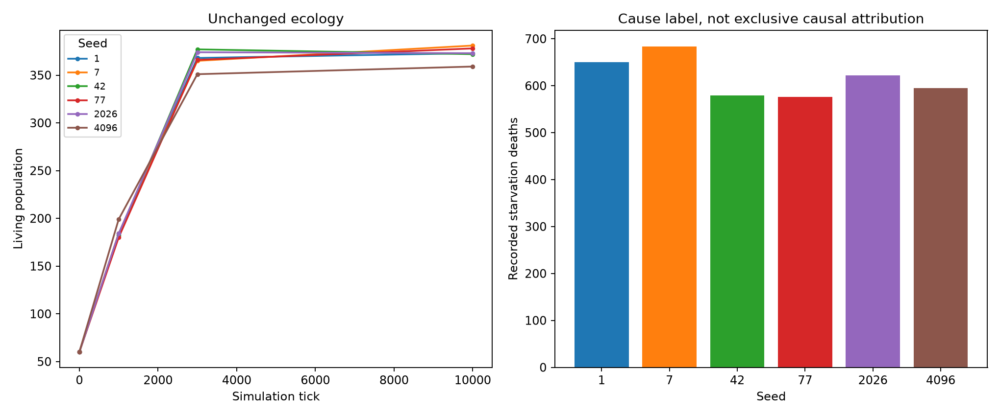
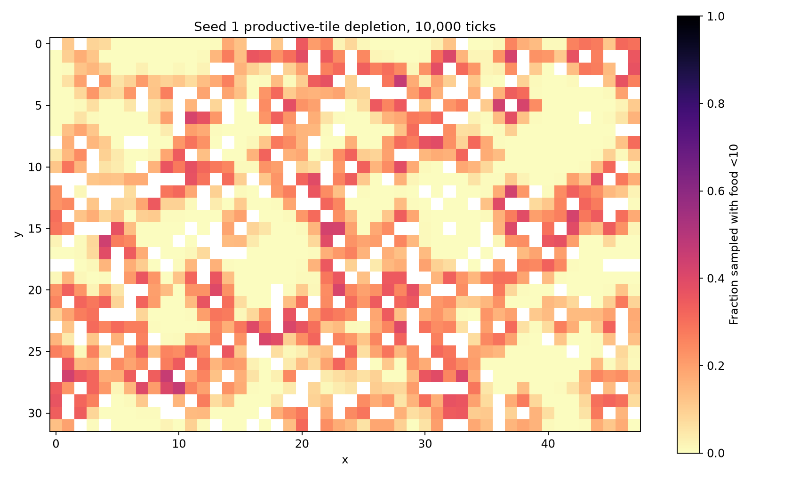

# Starvation: direct prospective evidence

Six unchanged worlds, seeds 1,7,42,77,2026,4096; 10,000 ticks each; exactly 60 decision
slots. No interventions or experimental biological rules. The 1k pilot and a
complete seed-1 10k uninstrumented replay matched canonical state/RNG exactly.
Three focused research tests also cover 3k natural deaths and continuation.
These observations do not reconstruct the player's missing historical decisions.

## Per-seed outcomes

| Seed | Living | Total born | Deaths | Recorded starvation | Final food |
|---|---:|---:|---:|---:|---:|
|1|373|2,017|1,644|650|69,122|
|7|381|2,036|1,655|684|67,760|
|42|372|1,935|1,563|579|70,142|
|77|378|1,928|1,550|576|67,172|
|2026|373|2,026|1,653|622|68,523|
|4096|359|1,955|1,596|595|70,713|

Total 9,661 deaths: 5,180 old age, 3,706 starvation, 544 dehydration, 231 hazard.
These cause labels are the engine's actual labels, not exclusive causal diagnoses.
In particular, prior injuries and both deprivation damage terms can contribute to
health reaching zero. No extinction occurred in this finite observation window.

## What hungry gnomes could observe and do

The sample unit here is a **gnome-tick**, not an independent individual or trial.
We sampled after biology and before scheduled decisions, with hunger>=80.

- 1,830,130 hungry exposures; all 1,830,130 had at least one tile containing>=10 food
 inside the actual sensory footprint. This is potential visibility, not proof
 that a reachable path existed or that a food query was evaluated by an earlier
 drink/eat branch.
- 372,720 of those exposures received a slot: 20.37% pooled, 19.999–20.833% across seeds.
 An unassigned gnome did not choose to wait. Biology still ran.
- 1,002,069 exposures (54.75%) were already on edible stock. Another 499,615 (27.30%)
 had 1–9 local units, below the actual eating threshold. The rest had zero local food.
- 78,339 hungry exposures (4.28%) were sleeping. The engine prevents starting sleep
 at hunger>=80 and wakes existing sleepers at>=85; this is a short remaining-sleep
 window, not evidence of deliberate starvation.

Actual hungry scheduled actions: 137,166 eating (36.80%), 143,850 movement (38.59%),
91,704 drinking (24.60%). No hungry reproduction/social/sleep decisions occurred,
consistent with the actual gates. In 50,903 decisions, edible food was present on
the current tile but the earlier drinking rule selected the action. This is direct
ordered-rule evidence, not a claim that drinking was irrational or caused a death.
Availability before the schedule can change before another gnome acts; actual
predecision local stock was sampled separately for this count.

At recorded starvation death, 2,099/3,706 individuals (56.64%) stood on>=10 food;
all 3,706 had an edible tile within sensory range. These were biological deaths
before scheduling; none made a new decision on that death tick. Regeneration can
also change local availability earlier in the same tick. We did not retain a full
per-tick stock trajectory, and cannot infer when that food first became edible.

This rejects “there simply was no visible food” as a general explanation **in
these runs**. It does not establish that expanding slots or changing action order
would improve survival: those interventions have not been tested here. Potential
mechanisms include food thresholds, pulse timing, need accumulation, earlier
injury, competition and decision latency, interacting through existing rules.

## Spatial pressure, traits and prior injury

The fixed map accumulators sample productive tiles every 10 ticks after regeneration
and before decisions. `depletion-seed-1.png` maps the fraction with<10 food; the
per-tile samples for all six worlds remain in JSON. No productive tile was below
10 food at 50% or more of these post-regeneration samples (maximum 49.7%). This
sampling can miss depletion between pulses. Food is unevenly depleted,
while substantial global stock remains. A global sum is not an access guarantee.

Every vision band (0–24,25–49,50–74,75–100) in this sample had edible potential
visibility on 100% of hungry exposures. Low-vision samples are relatively scarce
at this horizon; this does **not** prove vision is irrelevant at 428k ticks or
that larger sensory ranges have no path-quality effect. Curiosity bands also
showed high potential visibility. No randomized trait effect was estimated.

Prior hazard exposure occurred in 2,426/3,706 starvation deaths (65.46%), but also
4,630/5,180 old-age deaths (89.38%). Older survivors have more time to accumulate
exposure. These raw groups cannot show either protective or harmful causal effects
of injury. We did not control age, time at risk or injury dose.

757,094/1,555,048 actual moves (48.69%) revisited a location from that individual's
last 16 recorded movement origins. This bounded measure identifies repeated local
movement, not proof that the paths were inefficient. No optimal-path comparison
or counterfactual feeding route was computed.

## Limits and next experiment

Only 60,000 fresh-world ticks, six independent worlds; no claim of long-term
starvation frequencies or causal explanation for all 43,316 original deaths.
The first 128 example deaths per seed are retained without curating outcomes;
aggregate counters cover all deaths. Examples are an early, nonrandom subset.
Sleeping and unscheduled exposure are distinguished from actual decisions.
No complete agent biographies or new gameplay events were created.

A focused next research experiment could match hungry near-death decision
boundaries and vary slot opportunity **or** the eating/drinking ordering one at a
time in isolated controls. It should track regeneration-to-feeding latency and
health at risk. Such a result would be needed before blaming or changing those
production mechanisms. No such rule change is included in this campaign.

