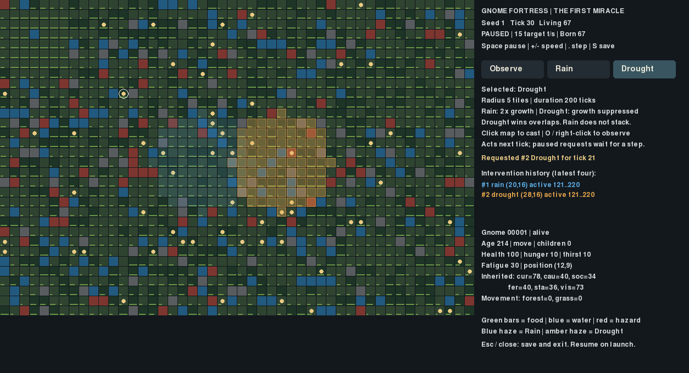

# G1 — The First Miracle: Rain & Drought

Launch the game:

```bash
cd ~/gnome-fortress && .venv/bin/python -m gnome_fortress.god_demo
```

This separate launcher starts with 60 founders, or resumes its existing gameplay
save at `run-results/god/world.g1.sqlite`. The ordinary research launcher is unchanged.
No communication research condition is implicitly enabled.

## Controls

- **Rain button / R**, then **left-click the map**: request Rain.
- **Drought button / D**, then **left-click the map**: request Drought.
- **Observe button / O / right-click**: stop targeting; click a gnome to inspect it.
- **Space**: pause/resume. **+ / −**: change target simulation speed.
- **Period**: advance one complete tick while paused. **Tab**: next individual.
- **S**: save. **Esc / window close**: finish pending save, save and exit.

The cursor highlights the exact affected cells. Blue haze marks active Rain;
amber marks Drought. History shows the latest four requests; the checkpoint retains
all records. The selected power remains selected after a cast. Repeated clicks
are separate recorded requests, not stronger stacked Rain. Inspection and targeting
remain responsive during saves; casting and stepping wait for the writer.

Both buttons use **radius 5 tiles** and **duration 200 simulation ticks**. A request
made at completed tick t activates at t+1, affects ticks t+1 through t+200 inclusive,
and expires at t+201, before that tick's regeneration and decisions. While paused,
a cast waits for a step. Duration is simulation time, not animation or wall time.
The visible ticks/second figure is the target speed, not a measured throughput.

### Exact environmental rules

The circular area uses integer `(x-center_x)^2 + (y-center_y)^2 <= radius^2`, clipped
to the map. Only grass and forest regenerate, on the existing ten-tick pulses.

| Terrain | Normal | Rain | Drought | Capacity |
|---|---:|---:|---:|---:|
| Grass | +4 | +8 | +0 | 100 |
| Forest | +8 | +16 | +0 | 100 |
| Rock, water, hazard | unchanged | unchanged | unchanged | unchanged |

Rain does not stack. Drought wins overlaps and never deletes existing supplies.
All effects are processed by increasing run-local intervention ID. The earliest ID
of the winning type receives resource-accounting credit; other covering effects
record overridden cells. This avoids counting the same food twice. Effects do not
consume RNG. No health, hunger, traits, movement scores or agent intentions are
set by a power. Gnomes perceive, move, eat, reproduce and die through existing rules.
Expiration restores ordinary regeneration; it does not undo consumed food or
reverse any consequences that already occurred elsewhere.

Each record contains its ID/type, requested and activation ticks, coordinates,
radius, duration, exclusive expiration tick, parameters, status, actual expiration
tick, and cumulative resource accounting. Events retain requests, lifecycle changes
and each active regeneration pulse. `delta` compares the actual increase with an
ordinary pulse on the **same pre-pulse stocks**, including capacity clamping; it
is not the final difference from another world's food stock. The Python API permits
radius 0..max(map dimensions), duration 1..10000; the UI uses the fixed defaults.
There is no mana, cooldown, morality path or progression.

## Saving, resuming and extinction

Saves use a dedicated `.g1.sqlite` suffix, SQLite application ID `0x474e4731`,
schema 1 and format `gnome-fortress-game-g1-v1`. A transaction atomically stores
one complete logical snapshot plus SHA-256. It includes RNG, all gnomes and history,
active/expired interventions, exact tick boundaries and resource ledgers. Loading
validates checksums, world invariants and intervention/history consistency. Existing
non-game, corrupt or incomplete databases are rejected before replacement.
Gameplay writes to the repository's `research/` tree are refused. Failed loads
never silently create a new world. Existing research SQLite formats are not modified.

The UI automatically checkpoints every 300 ticks and saves on clean exit/SIGINT/
SIGTERM. During the worker write it freezes simulation and casts while permitting
observation. Large snapshots may pause progress for longer; rendering stays available.

At zero living gnomes, progression stops permanently for that run. The extinction
panel displays final tick, total individuals born (including founders), total deaths,
interventions requested and final population 0. Queued/future expirations do not
advance after time stops. Ordinary controls cannot respawn founders.

For a **completely new world**, choose a new save filename:

```bash
.venv/bin/python -m gnome_fortress.god_demo --new --seed 2 --db run-results/god/second.g1.sqlite
```

`--new` refuses an existing file. This prototype is **not Ironman**: manual backup
restoration is not prevented, unsaved input may be lost on abrupt termination,
and automatic verified-checkpoint crash/corruption fallback is not implemented.
A load failure stops with an error; preserve the damaged file for investigation.
There is no fake Ironman mode.

## Actual build capture



[Initial 60 founders](captures/founders.png) · [Before casting](captures/before.png).
These were captured from the running X11/Pygame build at 1254×680 using the actual
key/click handlers. Inputs were scripted for repeatability; this was not a human
manual usability session. Both areas, previews, history and inspector were visually
reviewed from the resulting capture. No generated artwork is used.

## Verification and bounded demonstration

Initial model/storage tests: **13 passed**. Combined initial model/viewer checks:
**24 passed**. After history-integrity and shutdown checks, the relevant fast suite
passed **165 tests in 154.14 seconds**, including the existing research, persistence,
reference-equivalence and Observatory tests. Long-run and archive campaigns were
not run. [Full log](fast-tests.txt), [focused log](targeted-tests.txt).

Coverage includes map edges, exact radius, capacity, non-producing terrain,
activation and exclusive expiration, repeated clicks, overlap precedence, no direct
agent/RNG change on requests, deterministic replay, active-effect save/load,
transaction aborts, malformed/incomplete/corrupt data, research-file preservation,
paused rendering/inspection, varying redraw cadence, save-worker responsiveness,
SIGTERM, automatic resume and extinction. The exact pre-G1 engine at Phase 4C
`52374aa37b3f6bf5abf83b884c628f1bce5fb822` was also compared with the new standard
and inactive game worlds at ticks 0,20,100,300 for seeds 1 and 42: **eight exact
full-state/RNG checkpoints**. [Reference results](reference-verification.json).
The existing independent Phase 3 reference tests additionally passed through
1,200 ticks. No default biological or scheduling divergence was observed.

The actual standalone launcher ran for 30 X11 frames, saved cleanly at tick 14,
and resumed paused with the identical digest. [Launch](launcher-smoke.txt) ·
[Resume](resume-smoke.txt). The capture at tick 30 exercised Rain/Drought controls
through documented input events; active-effect save/reload is independently tested.

### Fixed 300-tick comparison

Seed 1, matched worlds. Request at tick 20; center (24,16), radius 8, duration 150.
Active ticks 21–170, expiration tick 171, fifteen regeneration pulses. These are
explicit test parameters; the playable controls retain radius 5 / duration 200.
All worlds matched exactly before the request. Every schedule replayed exactly,
and every save taken at tick 50 reproduced its continuation to tick 300.

| Condition | Local food delta vs ordinary pulses | Final living | Total born | Deaths | Final world food |
|---|---:|---:|---:|---:|---:|
| Observe | 0 | 88 | 89 | 1 | 114,676 |
| Rain | +4,948 | 95 | 95 | 0 | 113,572 |
| Drought | −10,851 | 89 | 91 | 2 | 111,374 |

Rain actually regenerated 10,309 units in its region; capacity-adjusted ordinary
regeneration on those same changing stocks would have been 5,361. Drought generated
zero there; its corresponding suppressed quantity was 10,851. Direct resource
changes outside the target region were ordinary regeneration only. Subsequent
agent movement, consumption and reproduction can have consequences outside it.

All three recorded deaths were **hazard deaths**, not starvation: observation
lost agent 53 at tick 54; Drought lost agents 72 and 44 at ticks 57 and 163.
Rain's larger final population is an observation from one short seed, not an
estimated survival benefit. Drought did not force population decline. Final food
stock includes independent consumption trajectories, so it need not be higher in
the Rain world. Once decisions diverge, shared-RNG consumption and later trajectories
differ. There is no claim that gnomes recognize a deity, benevolence or famine.

[Comparison CSV](results/comparison.csv) · [Complete parameters, ledgers, deaths and
replay results](results/comparison.json). The `eats` CSV field counts eat episodes
still in bounded agent memory, not lifetime eating events; hunger totals are raw
population totals, not per-capita estimates. The full small demonstration took
about 8.95 seconds and did not prescribe any gnome outcome.

Reproduce with unused output paths:

```bash
.venv/bin/python -m pytest -q tests/test_game.py tests/test_god_viewer.py
.venv/bin/python -m research.g1_demo --output run-results/g1-comparison-new
.venv/bin/python -m research.g1_verify_reference
.venv/bin/python -m research.g1_capture --output run-results/g1-capture-new
.venv/bin/python -m pytest -q tests research/test_analysis.py research/test_phase2.py research/test_study.py --ignore=tests/test_long_run.py
```

## Engineering changes and remaining limits

`GameWorld` is opt-in and inherits unchanged agent biology, memory, movement and
the 60-slot scheduler. The only core extension extracts the existing regeneration
block into `World._regenerate_food`; the default body and timing are unchanged.
This avoids copying the tick/biology/scheduling implementation into a game subclass.
The observer adds an optional `present=False` draw argument so the God interface
can reuse its map without a flickering intermediate display flip; default research
drawing still presents exactly as before. Research storage/runtime/launchers and
all earlier datasets are unchanged. Historical tags and commits remain intact.

The prototype uses full JSON snapshots inside SQLite, not incremental gameplay
storage. Save size/time and historical records grow with the run and player input.
Long-term save performance and abrupt-kill crash recovery are not certified.
UI sizing follows the existing fixed observer; there is no camera or artwork
overhaul. Only food regeneration is affected: Rain does not add water tiles and
Drought does not remove drinking water. Effect sizes/durations are not balanced.
There is no intervention undo/load menu, real-time weather model, society,
religion, advisor or Ironman enforcement. No pre-existing simulation defect needed
correction. No next gameplay milestone was started.
