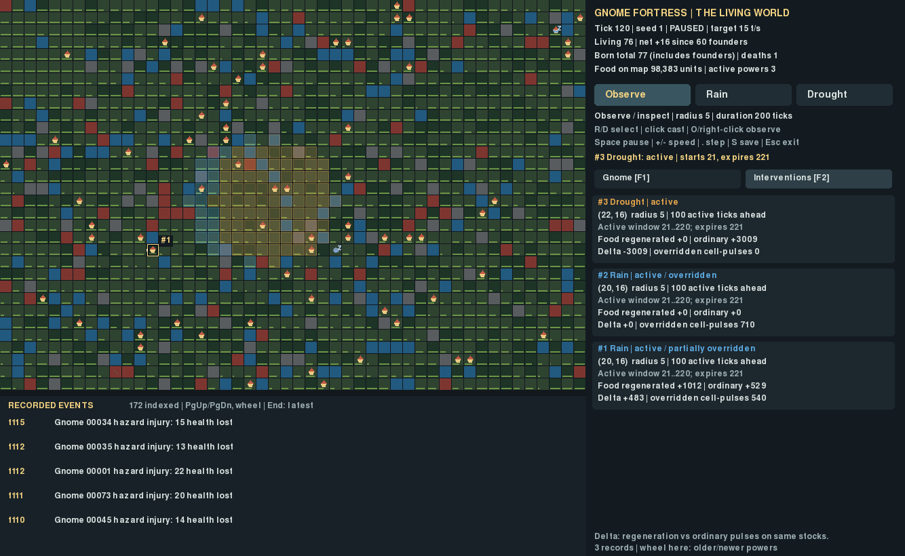
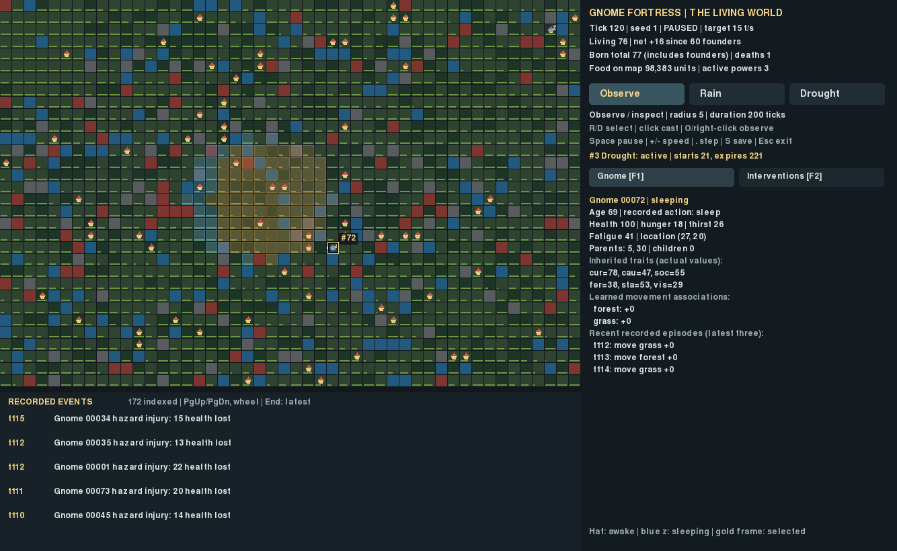

# G2 — The Living World

G2 is a presentation upgrade over accepted G1
`597b0eb9bfcbee438c1959c6a73b1b3591511358`. No simulation rules, save formats,
progression systems or release modes were implemented. The accompanying
[Game Mode Design Contract](../game-modes/CONTRACT.md) defines exactly three future
release modes: Ironman, Standard and Sandbox. Current saves remain legacy
prototype saves; they are not silently classified as Ironman.

## Launch and controls

```bash
cd ~/gnome-fortress && .venv/bin/python -m gnome_fortress.god_demo
```

The existing `.g1.sqlite` checkpoint resumes as before. Default path:
`run-results/god/world.g1.sqlite`. No conversion, metadata update or migration is
needed. Corrupt/invalid saves still fail without silently creating founders.

- **R / Rain**, **D / Drought**, then click the map to cast.
- **O / Observe / right-click** returns to read-only map inspection.
- Click a gnome or **Tab** to select; a gold frame and ID locate it on the map.
- **F1 / Gnome** shows identity, awake/sleeping/deceased status, actual action,
  parents/children, needs, traits, movement associations and three real memories.
- **F2 / Interventions** shows lifecycle, overlap, time boundaries and food ledgers.
  Mouse wheel over that panel browses older interventions.
- **Page Up / Page Down**, or wheel over the event strip, browses recorded events.
  **End** returns to the latest. Clicking an agent event selects that individual. Inspection shows its current or
  final stored record, not a reconstruction of unrecorded historical state.
- **Space** pauses/resumes; **+ / −** changes target tick rate; **period** single-steps
  while paused; **S** saves; **Esc / window close** saves and exits.

World status displays tick, living population, net change relative to the 60
founders, total individuals born (including founders), deaths, map food stock in
engine units, active intervention count and running/paused/saving/extinct state.
Birth totals and net population change are explicitly different quantities.
No happiness, prosperity, intelligence or civilization metric was added.

## Read the intervention cards

G1 behavior is retained: radius 5 / duration 200 ticks from the UI; Rain doubles
normal food regeneration, Drought suppresses it, capacity stays 100, Rain does not
stack and Drought wins overlaps. Power requests act at the next complete tick.

Each card shows ID/type, target/radius, lifecycle, activation and exclusive expiry,
future active ticks, actual regeneration, ordinary regeneration and their delta.
“Ordinary” means a normal pulse calculated on the **same actual pre-pulse tile
stocks**, including food-capacity clamping. Delta is not an estimate of a population
benefit or the final stock difference from a different world.

“Active ticks ahead” counts scheduled active ticks **after the currently completed
tick**: `max(0, expires - max(tick + 1, activation))`. A queued request has its full
duration ahead; after its last active tick it has zero ahead, and expires at the
next boundary. Exact windows and expiry are displayed to make that distinction
inspectable. In an extinct run time remains stopped, as in G1; future scheduled
boundaries do not occur.

“Active / overridden” and “partially overridden” are derived overlap annotations
for producing tiles at the current tick, not new persistent lifecycle states.
The canonical record remains active until its scheduled expiry. Overridden
cell-pulses are cumulative historical accounting and do not imply the effect is
still overridden now. Areas with no producing tiles are labeled accordingly.
The latest-request notification derives its current status rather than retaining
a stale request string.

## Actual running build





[Initial founders](captures/founders.png) · [Browsing older events](captures/events-browsed.png)
· [Expired powers and recorded expiration events](captures/powers-expired.png).

All images were captured from the actual X11/Pygame build at **1334×820**, with
scripted key/click input through the documented handlers. Capture metadata records
state digests, real feed entries, selected-agent values and power ledgers.
The individual shown is Gnome 00072, naturally sleeping at tick 120, parents 5 and 30.
No needs, traits or events were fabricated for that image. Hats mark awake agents;
blue bodies and a z distinguish sleepers. The selected marker is drawn above the
power regions. Each region cell receives its winning tint once, avoiding visual
stacking of physically nonstacking Rain.

Human usability testing: **none recorded**. The engineer inspected actual capture
images for readability; automated input and tests do not establish that the game
is enjoyable. Existing G1 presentation deficiencies and the corrected overlay issue
are documented in [DEFECTS.md](DEFECTS.md), not hidden as simulation changes.

## Architecture and efficiency

Only `god_viewer.py` changes among existing application modules.
`game_presentation.py` contains disposable, read-only views:

- Resource/population/power summaries cache at complete-tick/structural changes;
  they do not serialize telemetry or attach fields to GameWorld.
- An `array('Q')` event index makes one initial pass on load, then reads only
  appended events. It keeps sequence positions, not a second formatted history.
  The selected categories are birth, death, hazard injury, divine request,
  activation and expiry. Every displayed entry retains the recorded tick and
  agent ID where present. Social/wake/resource-pulse records remain in the world
  but are not included in this small feed.
- Each redraw reads a bounded page. A scrolled viewport stays anchored when new
  entries arrive; latest view follows new records. A source-list replacement or
  truncation resets the derived index. Normal gameplay history is append-only.
- Current overlap is derived from the existing producing-terrain and winner rules
  once per update. Visible card pages are bounded slices. Cosmetic layers use no
  simulation RNG or wall-clock animations. Inspection copies field values.

The event index uses eight bytes per selected position plus array/object overhead;
it grows with recorded history, but no extra persistent world log was introduced.
Initial indexing remains linear for very large checkpoints. Current food stock
requires one grid sum per changed world tick, not a historical-event scan.
G1 save validation itself still checks history; that existing operation is not a
per-frame viewer scan and was not changed in G2.

A 20,000-event synthetic-history test disallows full iteration/slicing and checks
that ten rendered frames read only the bounded feed page and the original
observer's three recent entries. Adding one event examines one new record.

A bounded 60-frame X11 sample at tick 120 (76 living agents) measured:

| Viewer | Window | Median draw | Mean draw |
|---|---|---:|---:|
| Accepted G1 | 1254×680 | 6.97 ms | 7.93 ms |
| G2 | 1334×820 | 7.15 ms | 7.62 ms |

Both left the complete logical world/RNG unchanged. This is a single sequential,
uncapped sample with different pixel dimensions, not evidence of a performance
improvement or a capacity guarantee. [Raw timing](render-timing.json).
No long-running performance campaign was launched.

## Verification

- Initial focused suite: **13 passed**, then **28 passed** with model coverage.
  Final focused suite: **30 passed in 16.05 seconds**.
- Full relevant fast regressions: **174 passed in 155.63 seconds**.
  [Focused log](focused-tests.txt) · [Full log](fast-tests.txt).
- Nine required compatibility/outcome checks: G1-writer saves with queued, active,
  expired and extinct states; matched Rain/Drought schedules for seeds 1 and 42;
  all three exact recorded G1 300-tick outcomes. The existing original G1 smoke
  checkpoint was also inspected read-only when present: **ten checks here**.
- Each of the four G1 save scenarios loads without changing source bytes, resumes
  exactly for 90 ticks, and round-trips through G2 into the accepted G1 reader.
  The versioned loader/writer modules are executed from the accepted Git source.
  The compressed active-save fixture is retained with producer/source/raw-state
  hashes. This is a fixture made by the accepted writer, not an invented migration.
- The actual standalone G2 launcher saved at tick 14 and resumed paused with the
  identical digest. Its prefix also matches a headless GameWorld at that tick.
  The launcher opened the active G1 fixture at tick 23 with the exact old digest.
- Tests verify render-frequency invariance, state/RNG nonmutation from browsing,
  accurate live request messages and expiry boundaries, current overlap versus
  old pulse accounting, resource summaries, missing optional inspection fields,
  bounded reads on long histories and current precedence in cosmetic coverage.
- Existing G1 tests for active save/load, worker responsiveness, corruption,
  interrupted writes, SIGTERM, shutdown and extinction all still pass. Existing
  standard-simulation tests match the independent reference through 1,200 ticks.
  No historical archive or endurance campaign was repeated.

[Compatibility results](verification/compatibility.json) ·
[G1 fixture provenance](verification/legacy-active.json) ·
[Launcher](launcher-smoke.txt) · [Resume](resume-smoke.txt) ·
[Legacy launcher](legacy-launcher.txt).

## Preservation and limits

Initial main was clean and exactly at accepted G1. The annotated **g1-verified**
tag was created at `597b0eb9bfcbee438c1959c6a73b1b3591511358`; no prior tag existed
locally or remotely, and no tag was moved or replaced. All old research files,
results, reports, screenshots and existing tests are preserved. The engine,
GameWorld, game/research storage, runtime, launchers, model and standard observer
are byte-identical to accepted G1. No Phase 4A–4C channel is enabled in production.
The final [preservation audit](preservation-audit.json) records hashes and tag targets.

The viewer is not a new simulation mechanic. Its derived overlap annotations do
not alter resource accounting, timing, mortality, reproduction, learning or the
60-slot scheduler. Checkpoints retain exactly the G1 format; mode identities,
policy/progression, migration, a final read-only chronicle and Ironman enforcement
remain future designs only. Opening the current prototype launcher still uses
G1's ordinary save-on-exit behavior; it is not that future read-only chronicle.

Limitations: fixed whole-map presentation rather than a camera; practical desktop
size requirements; long initial event-index construction on huge histories; no
human playtest; one rendering timing sample. Snapshot/history size and technical
crash recovery retain G1's limitations. Indexed history assumes canonical records
are not edited in place during observation. No G3 or Ironman work was started.

## Reproduce

```bash
.venv/bin/python -m pytest -q tests/test_game_presentation.py tests/test_god_viewer.py tests/test_game.py
.venv/bin/python -m research.g2_verify --output run-results/g2-verification
.venv/bin/python -m research.g2_capture --output run-results/g2-captures
.venv/bin/python -m research.g2_benchmark --output run-results/g2-render-timing.json
.venv/bin/python -m pytest -q tests research/test_analysis.py research/test_phase2.py research/test_study.py --ignore=tests/test_long_run.py
```

The fixture test uses the committed `docs/g2/verification/legacy-active.g1.gz`.
Timing and display dimensions vary by machine; scientific state/digest comparisons
do not use wall time. Find this milestone commit with
`git log -1 --format=%H -- docs/g2/README.md`; its full SHA is supplied at delivery.
