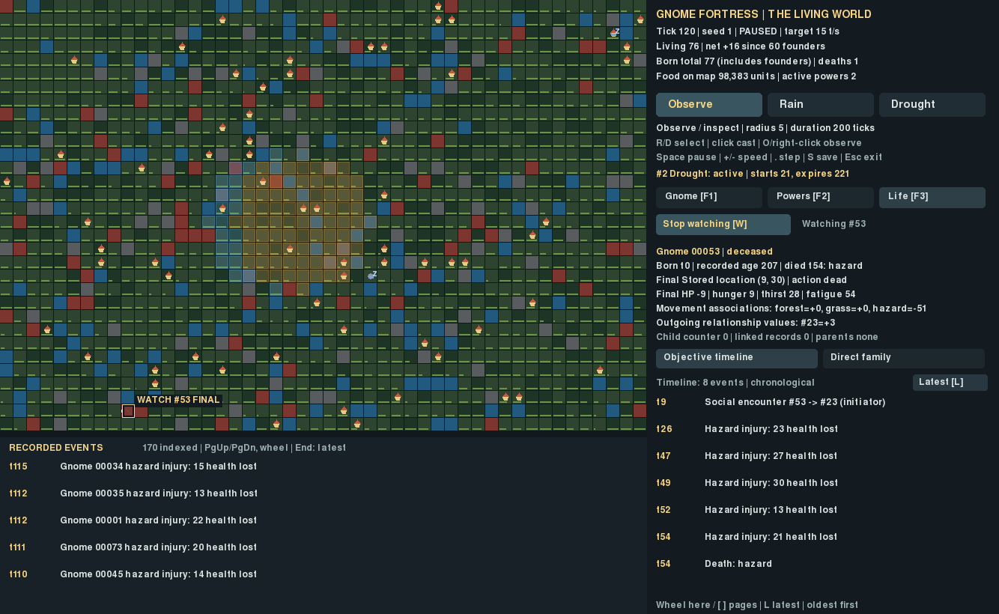
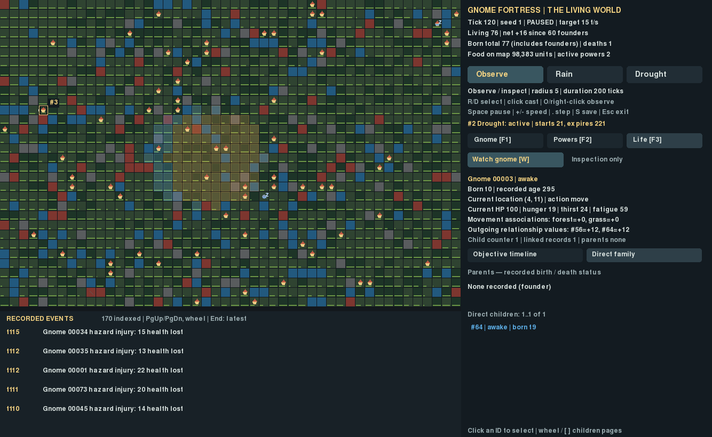

# G3 — The Witness

Accepted baseline: G2 `307e511335c6102e72e45d836dd8f07550271027`.
[Pre-implementation code review](CODE_REVIEW.md). The review found no confirmed
critical/major defect; the two related minor issues are handled below. Engine,
biology, relationships, powers, scheduler, save format and release-mode contract
remain unchanged.

## Launch

```bash
cd ~/gnome-fortress && .venv/bin/python -m gnome_fortress.god_demo
```

Existing G1/G2 `.g1.sqlite` saves resume with no migration. No new format, mode
selector, progression or Ironman feature is introduced. Corrupt saves still fail
closed; manual rollback prevention and automatic crash recovery remain unimplemented.

## Follow a life

Select a gnome on the map, in the global event strip, by Tab, or through family
navigation. **F3 / Life** opens the new view. **W / Watch gnome** starts watching;
press W again or Stop watching to stop. Watch adds no simulation command. Selection
remains on that identity across births, sleep, checkpoint writes and death. A gold
`WATCH #ID` marker stays above overlapping gnomes; deceased selections say `FINAL`.
A deliberate selection of another individual stops watching the old one.

Rain and Drought remain available while watching. Casting opens the power panel
but does not change the watched ID. F3 returns to Life; O disarms targeting without
stopping the watch. F1 returns to the existing compact inspector, F2 to powers.
The whole world stays visible; no camera-follow system is needed.

Life displays the **current or stored final snapshot** separately from objective
history: ID/status, birth tick, recorded age, death tick/cause when present,
current/final location, health/needs, recorded action, movement associations,
raw outgoing relationship values, child counter and retained family links.
Founders start with an existing age at tick zero; birth tick is not used to
invent their age or a pre-experiment life. Relationship numbers are directional
values, not friendship, loyalty or political affiliation.

### Objective timeline

Eligible records are own birth, reproduction as actor/partner/recorded child,
births naming the individual as parent, personal hazard injuries, logged social
encounters as initiator/recipient and own death. A child's birth and its parents'
reproduction are separate records at the same tick; the view preserves actual
record order and explicit roles. It does not turn the child into a reproducing
parent. Location/time proximity alone never attributes an event to a gnome.

Visible pages are chronological (oldest first within a page). Initial/latest view
follows the newest page. Wheel over the Life panel or **[ / ]** moves backward/
forward; an older page stays anchored while new events append. **L / Latest**
returns to the live tail. Global Page Up/Page Down/End retain their G2 meaning for
the separate world event strip.

A quiet individual may have only a birth record. Missing objective events are
not manufactured from memory, visits, nearby events or current needs. Bounded
64-entry episodic memory can evict an experience without erasing its objective
hazard/social/reproduction record. Eating, drinking, full paths and past needs
are not reconstructed when no corresponding objective history was recorded.
Relatives' deaths are visible in family records; they are not recast as the
selected individual's subjective experiences or inferred grief.

### Direct family

Inside Life, choose **Direct family**. Parents and direct children show stable IDs,
recorded birth tick and awake/sleeping/deceased state, plus death tick if present.
Click a member to select that actual individual. Missing referenced records are
labeled unavailable and cannot replace selection with an invented agent.

Children are derived from retained agents' actual parent IDs, not from names or
by inventing as many children as the numeric child counter suggests. The displayed
counter and linked-record count are separate. Only the selected individual's
children are indexed; the view never recursively renders an ancestry tree.
Wheel / [ / ] pages children in bounded groups. Entirely absent identity records
are not reconstructed as biographies; objective birth information may still appear
in the separate timeline if it exists there.

UI selection, Watch and scroll state are deliberately ephemeral. Saving while the
viewer is open preserves them; opening a new observer after reload starts with
selection 1, Watch off and fresh disposable indexes. The simulation resumes
exactly. Dead records remain inspectable, including after total extinction;
viewing them never advances an extinct world or resurrects founders.

## Actual build captures





[Quiet founder at tick zero](captures/quiet-founder.png) ·
[Child selected through family navigation](captures/descendant.png) ·
[Three-minute viewer smoke capture](watch-smoke/witness.png).

Captures use actual X11/Pygame drawing and scripted documented input. Seed 1 runs
normally; the capture casts the existing Rain and Drought at tick 20, just as an
ordinary player can. No births, deaths, relationships, needs or personal events
were injected for these images. Gnome 53 naturally died from a hazard at tick 54
and remains watched at tick 120; founder 3 has the actual child 64. Controlled
fixtures used in tests (e.g. 500 dead children and simulated disk failure) are
separate and are not presented as naturally occurring screenshot evidence.
Human usability session: **none**. Actual capture images were inspected for
readability; automated evidence does not establish enjoyment.

## Efficient history, not a biography archive

`life_presentation.py` maintains **one selected-identity cache**. Initial selection
scans existing events and retained agents once: O(E + A). It stores only unsigned
64-bit event positions and direct child IDs, plus at most two parent IDs. Switching
identity releases the prior arrays instead of keeping a population-wide collection
of personal timelines. Roles/text are computed only for the visible event page.

While visible or watching, updates inspect newly appended events and identities:
O(delta E + delta A), not the historical prefix. When hidden and not watched,
updates are deferred until needed. Family queries format a bounded page and parent
records, never the whole family. Canonical histories are append-only; replacing or
truncating a source resets the derived selected cache. No persistent telemetry,
full biographies, significance rankings, path archive or new World fields exist.

Memory is O(selected relevant events + selected direct children), approximately
eight bytes per retained position/ID plus containers; existing global G2 indexing
is separate. Selection on an enormous history can still pause for its initial
scan. Whole-world rendering/sorting and full JSON saves retain the architectural
debt identified in the review; G3 does not claim indefinite fixed memory or constant
cost for ever-growing populations. The missing-reference guards are not a repair
system for corrupted saves; loaders continue rejecting invalid checkpoints.

## Related fixes

1. The accepted G2 retry loop attempted the same failed overdue save eight times
   in eight controlled frames. G3 attempts once, pauses, and inhibits automatic
   retries until an explicit save succeeds. S can retry; a successful save resumes
   the normal checkpoint interval. The ordinary explicit exit save still runs.
   A user may explicitly resume without a successful retry in this prototype;
   this is not Ironman durability enforcement.
2. Deceased selections now label coordinates **final stored**, including the F1
   inspector. Neither this label nor Watch changes the gnome's biological state.

[Retry reproduction and compatibility](verification/compatibility.json).
No unrelated engine refactor or confirmed simulation-defect correction was needed.

## Verification and boundaries

See [focused results](focused-tests.txt), [full fast results](fast-tests.txt),
[compatibility evidence](verification/compatibility.json), and
[preservation audit](preservation-audit.json). The final executed counts and bounded
smoke observations are recorded in [RESULTS.md](RESULTS.md).

Tests cover actor/partner/child/parent attribution, directional encounters,
chronology, missing data, memory eviction, family lookup/pagination, 500 deceased
children, overlapping gnomes, watched death, stable scroll anchoring, no state/RNG
mutation, cadence invariance, active powers, legacy saves and viewer save recovery.
The 20,000-event guarded-history test rejects full iteration/large slices and
checks bounded reads per draw after initial indexing. G1/G2 writer snapshots load
unchanged, round-trip to the old readers and continue identically; retained G1
outcome digests also match. Existing tests cover corruption, interrupted writes,
SIGTERM, extinction and independent research reference equivalence.

No long historical archive or artificial-life research campaign was run. The
three-minute smoke is an operational viewer check at target 15 ticks/second, not
a population study or proof of permanent stability. No new modes, powers,
experimental communication, religion, social mechanics or G4 work was started.

## Reproduce

```bash
.venv/bin/python -m pytest -q tests/test_life_presentation.py tests/test_game_presentation.py tests/test_god_viewer.py tests/test_game.py
SDL_VIDEODRIVER=dummy SDL_AUDIODRIVER=dummy .venv/bin/python -m research.g3_verify --output run-results/g3-verification
.venv/bin/python -m research.g3_capture --output run-results/g3-capture
.venv/bin/python -m research.g3_watch_smoke --output run-results/g3-watch --seconds 180
.venv/bin/python -m research.g3_verify --output run-results/g3-verification --smoke-report docs/g3/watch-smoke/watch-smoke.json
.venv/bin/python -m pytest -q tests research/test_analysis.py research/test_phase2.py research/test_study.py --ignore=tests/test_long_run.py
```

Frame timing and resulting real-time smoke tick counts depend on the machine;
recorded tick inputs, state/RNG continuation and deterministic comparisons do not
use wall time as simulation input. Find the milestone commit using
`git log -1 --format=%H -- docs/g3/README.md`; the full SHA is supplied at delivery.
