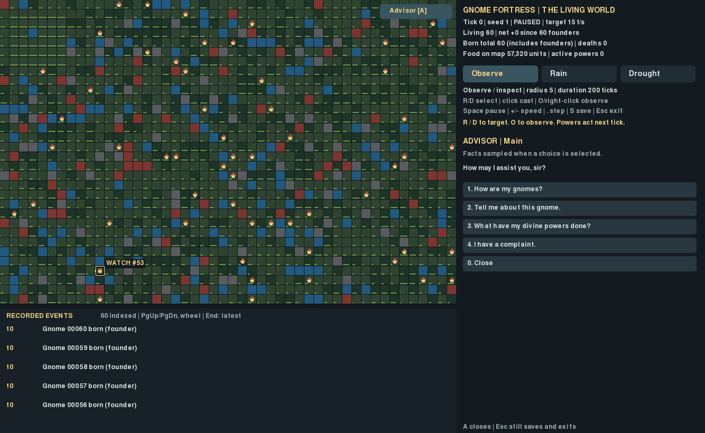
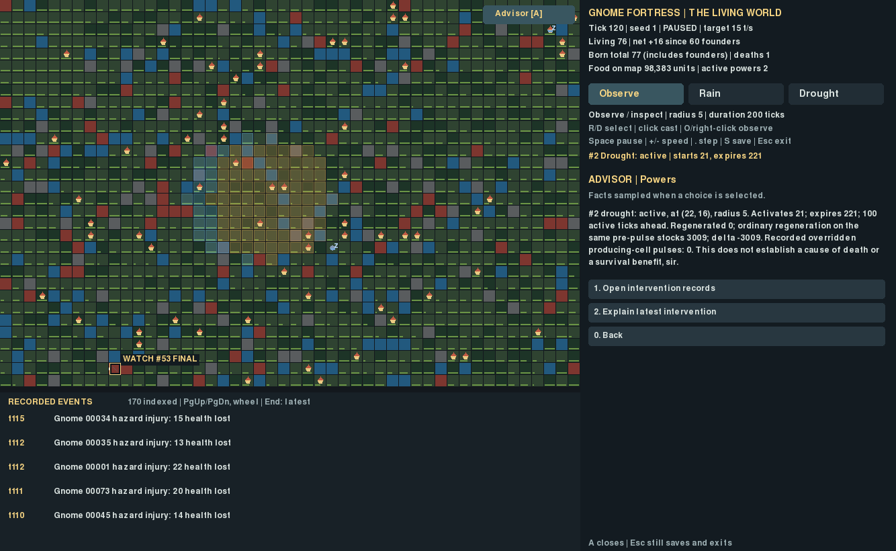

# G4 — The Advisor

Launch:

```bash
cd ~/gnome-fortress && .venv/bin/python -m gnome_fortress.god_demo
```

Click **Advisor [A]** at the upper right of the map, or press **A**. Choose with
number keys or mouse; **0** returns to the main menu or closes it. **A** closes
from any topic. **Escape still saves and exits** through the existing launcher.
The world continues according to the existing pause/speed controls. Opening the
Advisor does not pause it. Facts are sampled when a choice is selected and may
become historical while the world advances; reselect the topic to refresh them.

The four topics are world status, selected gnome, divine interventions and
complaints. Population statistics opens the existing world header; recorded
events opens the existing global feed at its latest page. Life, Direct Family and
intervention records open their existing panels. Navigation preserves selected
identity and Watch. Power targeting, pause, speed, save and exit remain available.
The Advisor covers the side-panel inspection area while open; the world, global
feed and world statistics remain visible. Number keys are consumed by dialogue;
map actions remain explicit gameplay input, not dialogue consequences.

## Implementation

`gnome_fortress/advisor.py` contains one ephemeral page, a response string and
explicit `if / elif / else` branches. `god_viewer.py` handles the button, digits,
mouse hit areas and navigation. No new dependencies, graph, compiler, model API,
NPC entity or permanent NPC memory exists. UI state resets on relaunch.

Responses reuse WorldPresentation and Life facts. Recent deaths are the latest
five death events from the existing incremental event index; this query runs on
choice, never each rendered frame. No duplicate global browser or persistent
biography is created. A death summary uses its recorded cause and tick; living
and sleeping gnomes are not described as dead. Missing selections are explicit.

The latest intervention explanation reports ID, type, status, coordinates,
radius, activation/expiration, future active ticks and resource totals. Current
override statements use current derived producing-cell coverage. Cumulative
`overridden_cells` is labeled **producing-cell pulses**, not a present-day area.
Regeneration delta compares actual regeneration to normal regeneration on the
same pre-pulse stocks. It is not a population benefit or a death attribution.
No intervention records produces an explicit empty response. Complaint jokes
are predefined character lines; mountain lions remain unimplemented.

## Evidence and limitations

See [engineering results](RESULTS.md), [targeted tests](targeted-tests.txt),
[fast regression tests](fast-tests.txt), and [compatibility/preservation evidence](evidence/verification.json).
The baseline inspection and implementation boundary are in [PLAN.md](PLAN.md).
No simulation defect required correction. No core behavior, save schema or mode
contract change was made. Full snapshot cost, growing historical records and
initial indexing remain existing limitations. This is a short dialogue tree,
not an autonomous interpreter or exhaustive causal explanation system.

Actual X11 Pygame captures use natural seed-1 biology and scripted key/mouse
inputs. No births, deaths, memories or events were injected for the captures.
Founder 53 naturally died at tick 54 after the ordinary Rain/Drought requests
at tick 20. That temporal sequence does **not** establish a causal link.
The operational script checks read-only drawing, actual navigation, preserved
Watch, save/load and Escape. Human usability sessions: **none**; screenshots
were visually inspected, not presented as evidence of enjoyment.




## Reproduce

```bash
.venv/bin/python -m pytest -q tests/test_advisor.py tests/test_life_presentation.py tests/test_game_presentation.py tests/test_god_viewer.py
SDL_VIDEODRIVER=x11 SDL_AUDIODRIVER=dummy .venv/bin/python -m research.g4_verify --output run-results/g4
.venv/bin/python -m pytest -q tests research/test_analysis.py research/test_phase2.py research/test_study.py --ignore=tests/test_long_run.py
```

The operational check needs a working desktop for actual X11 captures; use SDL's
dummy driver for compatibility checks without claiming a desktop check. It
compares unchanged authoritative files, loads checkpoints made by accepted G1,
G2 and G3 storage code, tests old-reader round trips and 90-tick continuation,
and audits existing files without altering their source records. Historical CSV
CRLF checkout normalization is permitted only when it matches baseline Git data.
No long research or historical archive campaign is needed or executed.

No G5, new powers, predators, LLMs, modes or Ironman implementation.
