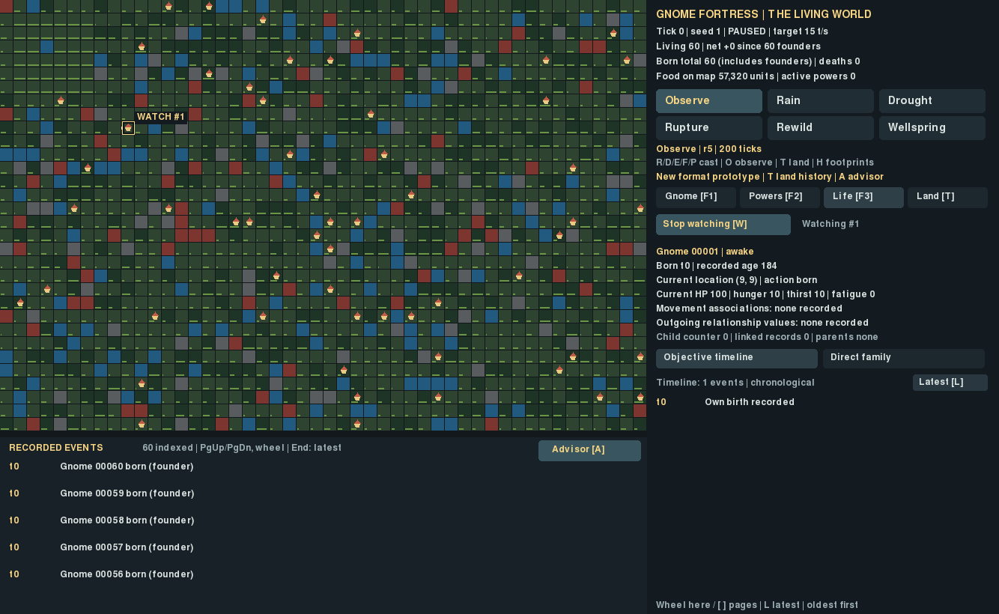
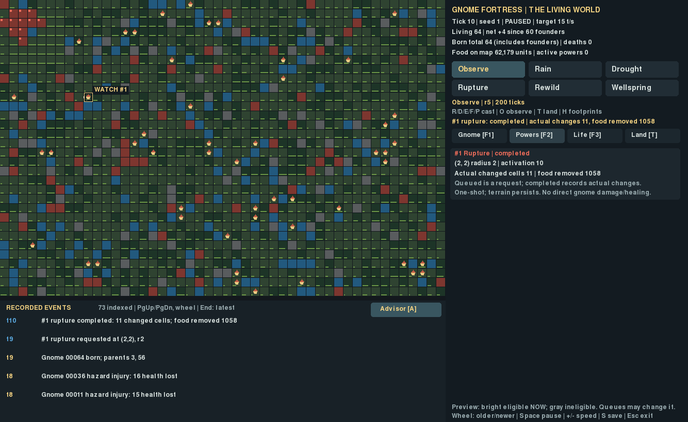
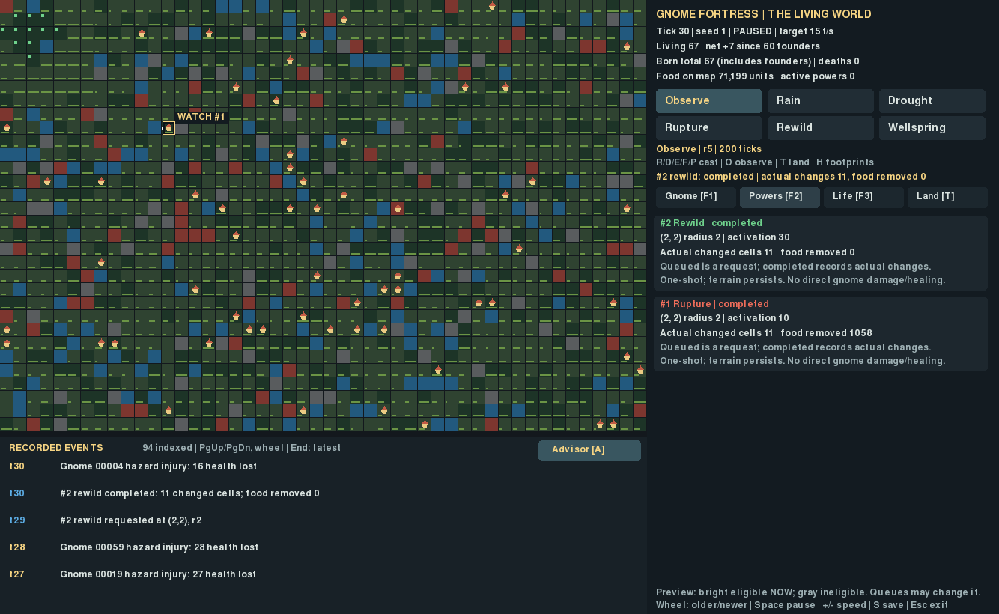
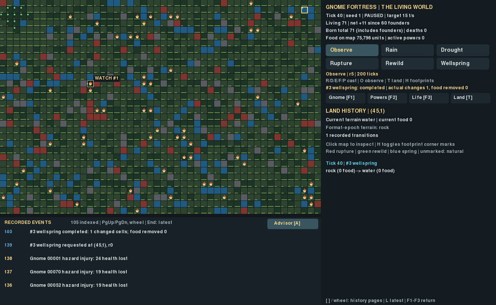
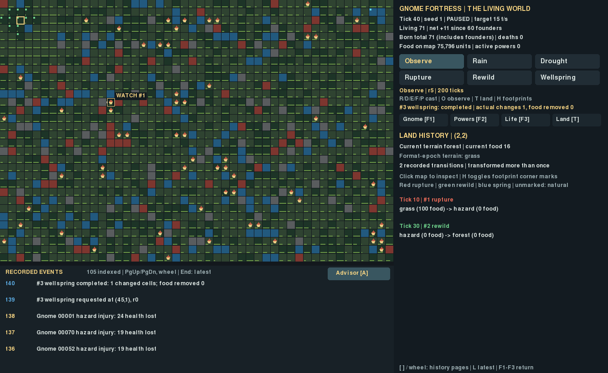
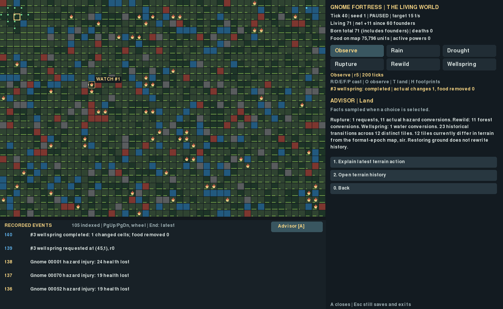

# G7 — The World Remembers

Scoped presentation gate PASS; final integration/campaign results are recorded
separately in the overnight handoff. This is an opt-in terrain prototype, not
release modes, Ironman, progression or experimental communication.

Launch a fresh preserved world:

```bash
cd ~/gnome-fortress && .venv/bin/python -m gnome_fortress.god_world --new --db run-results/god-terrain/my-new-world.g5.sqlite
```

Resume using the same `--db` without `--new`. The new default terrain path is
separate from the user's old G1 game. Original launcher remains
`.venv/bin/python -m gnome_fortress.god_demo`.

## Controls and facts

Six full-size buttons occupy two rows: Observe, Rain, Drought, Rupture, Rewild,
Wellspring. Keys **R/D/E/F/P** select powers. Click the map to request; effects
activate at the next complete tick. **O/right-click** observe. **T/Land tab** enters
tile inspection; click a tile. **H** toggles small last-transformation corner marks.
**A** opens Advisor; topic **5** reports actual land changes. **F1/F2/F3**, **W**,
**Space**, **+/-**, **.**, **S** and **Esc** retain their existing functions.

Terrain previews draw the exact circular footprint (single tile for Wellspring):
bright cells are currently eligible; gray are ineligible. Queued predecessors may
change eligibility. Requests and completed actual counts are labeled separately.
Rain/Drought still use their established radius/duration and actual food ledgers.

Land shows coordinates, current food/terrain, format-epoch terrain and chronological
per-cell before/after records with tick/ID, including multiple transformations.
Use wheel or **[ / ]** for bounded pages, **L** for latest. Older pages remain
anchored as history grows. Footprints distinguish the last recorded Rupture,
Rewild or Wellspring; unchanged natural terrain has no mark when overlay is on.
Actual terrain, not tint, controls the simulation. Watch/selection remain stable.

Advisor keeps explicit conditional branching; the legacy four topics remain.
Terrain summary distinguishes total transitions, distinct ever-transformed tiles,
and tiles whose current terrain differs from the format-epoch map. Rewild can
return an original forest to its epoch terrain; that does not erase its history.
Latest action and land-navigation choices are real. One-shot powers are never
misrepresented as timed rain or automatic survival benefits.

## Implementation and cost

Small presentation hooks in GodObserver default to original G4 classes, colors,
labels, navigation and observer type. TerrainObserver supplies new presentation,
Advisor and input/overlay hooks; the checkpoint loop is shared. No engine/model,
legacy game/storage, runtime or old launcher modification. A worker-pending
checkpoint blocks all casts and stepping; UI inspection/Advisor remains read-only.

TerrainIndex scans initial objective events once, then only appended events and
transitions. It stores per-tile references into authoritative records, no copied
biographies, paths or second database. Space is O(recorded transitions + affected
tiles), not constant forever. Tile queries/pages are bounded; map corner painting
is bounded by map cells. Existing world summaries and power cards still have their
original per-tick costs; final profiling reports measurements instead of assuming
infinite scaling.

## Executed checks and defect

- 61 targeted tests passed in 16.70s, including legacy Advisor, Life/Watch, feed,
  all new terrain gates, paging, exact cadence, provenance and read-only behavior.
- Separate legacy-hook regression: 34 passed in 10.71s.
- Initial G7 integration: 2 failed, 59 passed. A new map-top Land button intercepted
  targeting on small terminals. Recorded before correction. Land is now a fourth
  inspection tab; terrain Advisor button is in the event-header margin, leaving
  every map tile targetable. Assertions were retained; rerun passed. See preserved
  [initial log](initial-targeted-tests.txt) and [passing log](targeted-tests.txt).
- Actual X11 Pygame 1334×820, seven real screenshots and 120 unpaused frames;
  UI-requested terrain changes, Watch, actual save/reload and Escape checked.
  Natural seed-1 biology; no injected deaths, families or dramatic event fixture.
  Human usability sessions: none. Main land-history and Advisor captures visually
  inspected. This does not establish subjective enjoyment.








Reproduce the scripted actual capture (use an unused output directory):

```bash
SDL_VIDEODRIVER=x11 SDL_AUDIODRIVER=dummy .venv/bin/python -m research.overnight_capture --output run-results/terrain-capture
```

[Capture facts](captures/capture.json), [capture log](capture.log),
[predeclared comparison](../overnight/EXPERIMENT_PROTOCOL.md). No G8 started.
