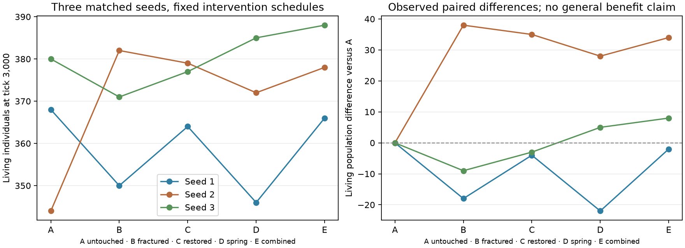

# Bounded matched-world results

Predeclared protocol: [EXPERIMENT_PROTOCOL.md](EXPERIMENT_PROTOCOL.md).

All 15 primary runs reached 3,000 ticks. Every primary matched its independent
replay in complete state/events/RNG, its tick-250 checkpoint reloaded exactly,
and its final checkpoint continued another 20 ticks exactly. The three untouched
worlds matched the preserved Phase 3 reference in complete World state.

Conditions: A untouched; B Rupture; C Rupture then Rewild; D Wellspring;
E Rain/Rupture/Drought/Rewild/Wellspring. Timings/targets are fixed in the protocol.

| Seed | A living | B living | C living | D living | E living |
|---|---:|---:|---:|---:|---:|
| 1 | 368 | 350 | 364 | 346 | 366 |
| 2 | 344 | 382 | 379 | 372 | 378 |
| 3 | 380 | 371 | 377 | 385 | 388 |

Rewild versus Rupture alone changes final living counts by **+14, −3, +6**.
Rupture versus untouched changes them by **−18, +38, −9**. These are three
finite observations, not a general survival effect or an individual causal
attribution. We do not rank benevolence from these outcomes.

Rewild changes hazard into forest; it does not reconstruct original grass or
forest. It can also transform natural hazard inside the footprint. Seed 2 had
9 Rupture conversions and 11 Rewild conversions; seed 3 had 9 and 10. The
comparison therefore includes physically different resource terrain and retained
learning, not rollback. All prior injuries/deaths remain in the objective log.

| Seed | Condition | Born total* | Deaths | Hazard entries | Rupture-ground entries** | Food stock |
|---|---|---:|---:|---:|---:|---:|
| 1 | A | 607 | 239 | 1001 | 0 | 71319 |
| 1 | B | 599 | 249 | 1062 | 108 | 69691 |
| 1 | C | 614 | 250 | 948 | 10 | 71656 |
| 1 | D | 602 | 256 | 992 | 0 | 71195 |
| 1 | E | 610 | 244 | 911 | 19 | 72336 |
| 2 | A | 575 | 231 | 1131 | 0 | 70799 |
| 2 | B | 584 | 202 | 1204 | 34 | 66937 |
| 2 | C | 618 | 239 | 1160 | 0 | 68744 |
| 2 | D | 592 | 220 | 1205 | 0 | 68133 |
| 2 | E | 603 | 225 | 1171 | 1 | 69355 |
| 3 | A | 613 | 233 | 1043 | 0 | 70641 |
| 3 | B | 624 | 253 | 1038 | 27 | 69364 |
| 3 | C | 611 | 234 | 1041 | 3 | 71442 |
| 3 | D | 620 | 235 | 1041 | 0 | 70109 |
| 3 | E | 600 | 212 | 1018 | 2 | 71892 |

*Born total includes the 60 founders; offspring births are recorded separately.
**Requires real hazard-event coordinates and a prior transformation to hazard
at that event tick. It is not a counterfactual earthquake death attribution.

No fixed direction of population benefit is demonstrated. Each spring created
one water tile, but lifetime spring drinking is not exhaustively recorded.
Water can affect perception/movement even before a drink. We do not infer who
used a spring from nearby deaths or surviving families. After changed decisions,
RNG consumption diverges across conditions despite matched initial seeds.



## Separate optional operational check

The combined seed-1 schedule reached **10,000 ticks**: **375 living**, **2,063 total individuals**,
**1,688 deaths**, **3,011 hazard entries**. It retained 25 terrain transitions,
with exact independent replay and save/load-plus-20 continuation. This is one
bounded operational check, not a permanent-stability or matched survival study.

Primary verified execution: 33.84s; independent replay: 32.78s.
Worker CPU total: 74.62s; peak RSS: 494.3 MiB (includes multiple worlds and verification).
New checkpoint creation: 0.97s / 19,865,600 bytes; this is not an existing-file update timing.

## Data and reproduction

Full per-seed JSON records preserve exact requests, transitions, composition,
death causes, state/RNG digests, timings and checks. CSV includes death-cause
columns. `untouched_reference_exact=null` means not applicable to an intervened
condition, not a failed reference test. Primary timings include initial equality
checks and save/load/validation; they do not isolate the computational cost of
powers. Workers run separately; CPU/RSS describe each worker including replay.
Concurrent regressions can affect wall-clock measurements. No performance ranking
is inferred from condition timings.

```bash
.venv/bin/python -m research.overnight_study --output run-results/terrain-study/experiments --ticks 3000
.venv/bin/python -m research.overnight_study --worker --seed 1 --condition E --ticks 10000 --output run-results/terrain-operational
.venv/bin/python -m research.overnight_figures --output run-results/terrain-study
```

Figures use existing `research/requirements-tested.txt` matplotlib; runtime
gameplay adds no dependency. [Raw summaries](experiments/summary.json),
[CSV](experiments/summary.csv), [execution log](campaign.log),
[extended record](extended/E-seed-1-ticks-10000.json). No targets or fixtures
were tuned after outcomes; no old research dataset was modified.
