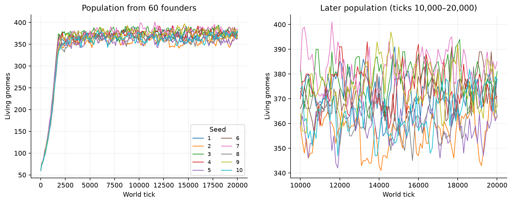
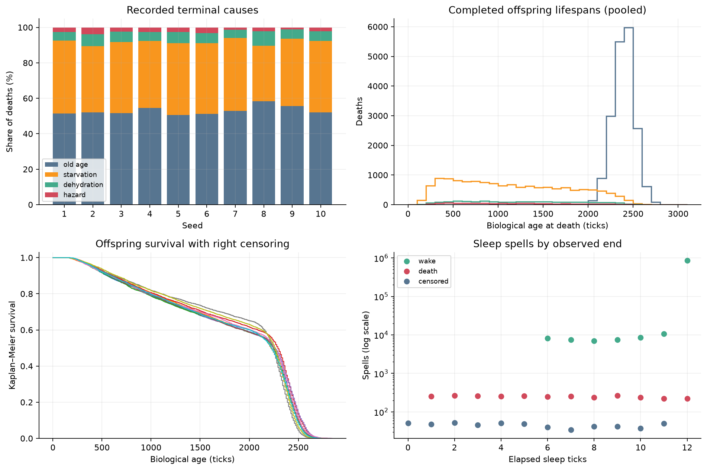
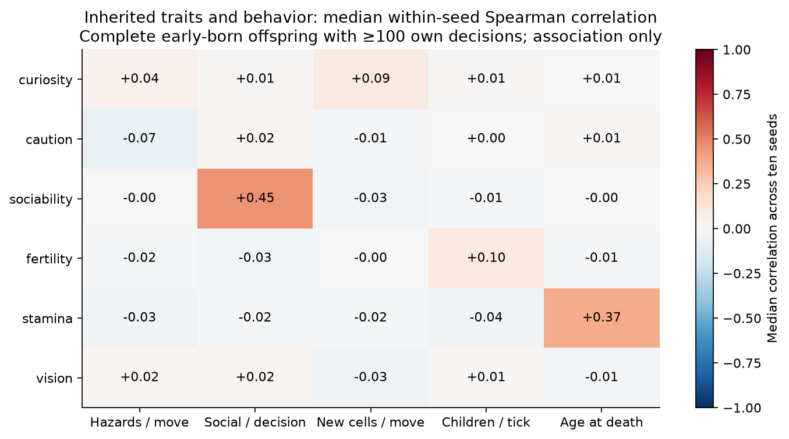

# Gnome Fortress: Phase 1 population study

**Ten unchanged worlds grew rapidly from 60 founders and then remained near a population
plateau, with ongoing births and permanent deaths.** None became extinct during
20,000 ticks. This is evidence of a bounded, fluctuating regime over the observed
horizon, not proof of indefinite stability or a regular population oscillator.

Baseline **f32c1a6** is preserved as **phase0-verified**. Seeds **1–10** used the original
48×32 world, 60-slot scheduler and all existing rules. No interventions or new
behaviors were introduced. [Protocol](PROTOCOL.md) · [Definitions and reproduction](DATA_DICTIONARY.md).

## Population

| Seed | Living at 20,000 | Total births, including founders | Deaths |
|---:|---:|---:|---:|
| 1 | 378 | 4,093 | 3,715 |
| 2 | 363 | 3,901 | 3,538 |
| 3 | 381 | 4,175 | 3,794 |
| 4 | 371 | 3,994 | 3,623 |
| 5 | 363 | 3,923 | 3,560 |
| 6 | 367 | 4,071 | 3,704 |
| 7 | 385 | 4,110 | 3,725 |
| 8 | 363 | 3,882 | 3,519 |
| 9 | 368 | 4,007 | 3,639 |
| 10 | 377 | 3,998 | 3,621 |
| **Total** | **3,716** | **40,154** | **36,438** |

Growth slowed around tick 2,000. Final populations were **363–385** (mean **371.6**).
Exact event reconstruction found **no extinct tick** in any world; the largest
population was **405**. During ticks 10,000–20,000, sampled mean populations ranged
**356.4–382.3**, detrended variability was **1.65–2.34%** of the mean, and linear slopes
ranged **−0.23 to +1.23 gnomes per 1,000 ticks**. The last/preceding 5,000-tick mean
ratio was **0.996–1.016**. Some worlds retained small upward drift.

[Autocorrelation and spectra](results/dynamics.png) show short-term dependence and
seed-dependent peaks, not a validated common cycle. No unbounded growth was observed;
a finite horizon cannot exclude later growth, collapse or long cycles.

## Mortality, lifespans and sleep

Recorded death labels were **old age 19,309 (53.0%)**, **starvation 14,132 (38.8%)**,
**dehydration 2,104 (5.8%)**, and **hazard 893 (2.5%)**. These are terminal-rule labels;
combined hunger/thirst damage is not separately attributed.

The **35,838 completed offspring lifespans** had median **2,232 ticks**, 10th–90th
percentiles **559–2,496**, and range **57–2,844**. The **3,716 living offspring** are
right-censored, not completed short lifespans. All 600 founders died; their pre-existing
ages were handled separately. Survival curves retain censoring and distinguish this
from the completed-death distribution.

Of **903,299 sleep spells**, **899,780** ended in waking, **2,977** ended in death
without a wake event, and **542** were ongoing at the cutoff. Completed sleeps had
median **12 ticks**; **49,517 (5.5%)** ended earlier because of the existing need-driven
wake rule. Death-ended spells had median observed duration **6 ticks**.

## Scheduling and inherited traits

Across 200,000 world ticks, agents executed **11,988,178 of 12,000,000 possible own
decisions (99.90%)**. End-of-tick slot occupancy was **92.37%** because sleeping/dead
agents had relinquished slots. **80.18% of awake eligibility opportunities received
no decision slot**; this is a fraction of opportunities, not a fraction of agents
permanently excluded. Biology continued for everyone. [Scheduling plot](results/scheduling.png).

The decision budget is therefore a plausible contributor to the plateau and
need-related mortality. This is an interpretation of the observed load and known
rules, not a causal capacity experiment or proof that food scarcity is irrelevant.

For **30,117** early-born offspring with complete lifetimes and at least 100 own
decisions, median within-seed Spearman associations were:

| Trait and measured behavior | Median correlation | Across-seed range |
|---|---:|---:|
| Sociability → social initiations / decision | +0.449 | +0.427 to +0.512 |
| Stamina → age at death | +0.370 | +0.339 to +0.422 |
| Fertility → children / observed tick | +0.099 | +0.074 to +0.132 |
| Curiosity → new cells / move | +0.091 | −0.076 to +0.229 |
| Caution → hazards / move | −0.070 | −0.134 to +0.040 |

Vision associations were weak across the measured endpoints (absolute median
correlation ≤0.033). These observations align partly with programmed trait effects;
they are **associations**, not evidence of emergent personalities or independently
learned social systems. Relatedness, location, cohort and survivor selection remain
confounders. No agent-level significance claims are made.

## Observer and verification

The real SDL **X11** window was opened and rendered frames were visually inspected.
OS-delivered keyboard events confirmed pause, one paused tick, speed changes,
Tab inspection, save request with exact reload, resume, and Escape. This was assisted
UI verification, not physical human input. Mouse targeting through XSendEvent was
inconclusive; physical clicks, native Wayland interaction and the window-manager
close button remain unconfirmed. The original automated mouse test passes.
[Check record](observer/checks.json) · [Frame](observer/paused-inspection.png).

The original **27 tests passed in 168.33 seconds**, including the original endurance
and replay test. Six additional research tests passed. All ten final SQLite archives
reconciled with telemetry, ancestry and population accounting. The measurement
wrapper passed exact-state comparisons against the original engine. A separate
uninstrumented 20,000-tick replay of seed 1 is recorded in
[verification.json](results/verification.json). Baseline source and tests are unchanged.
[Documented limitations/defects](DEFECTS.md) were not fixed by changing rules.

## Next experiment

Run the [pre-specified memory experiments](MEMORY_EXPERIMENTS.md): first compare
identical natural-state clones differing only in movement-association readout, then
30 paired whole-world enabled/disabled seeds. Keep visits, traits and all other rules
fixed. Later random shocks diverge after choices diverge; use world seeds as the
replication unit. These population treatments were **designed, not executed** here.
The rerun baseline memory test (0/100 hazard choices versus 54/100 with associations
erased) establishes a local mechanism, not a lifetime survival benefit.

Extend unchanged baselines to 100,000 ticks separately before claiming stationarity.
Ten seeds, administrative censoring, ancestry, sampled time series and the absence
of a whole-world ablation limit the present conclusions. The evidence shows a busy,
continuously turning-over population near a plateau, with measured trait differences;
it does not demonstrate civilizations or other unimplemented behavior.
