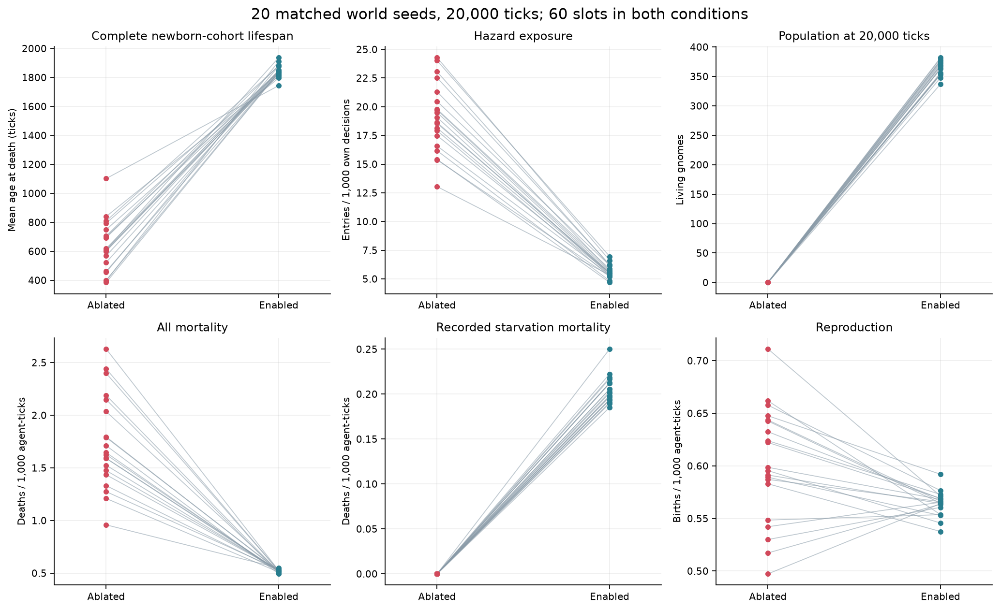
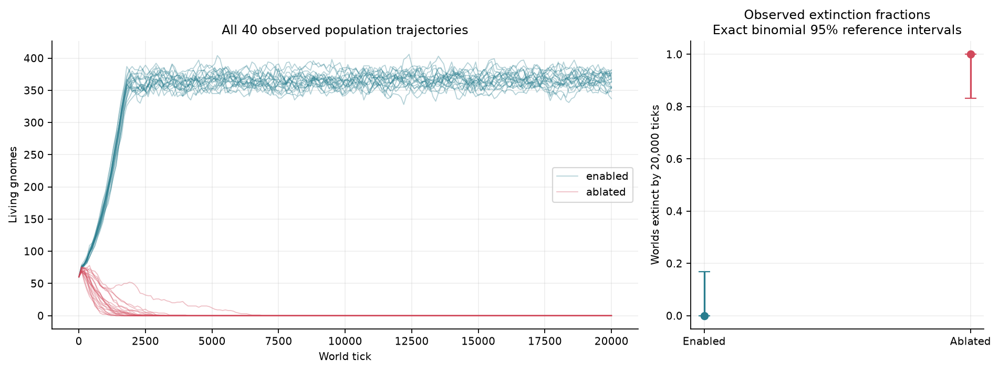
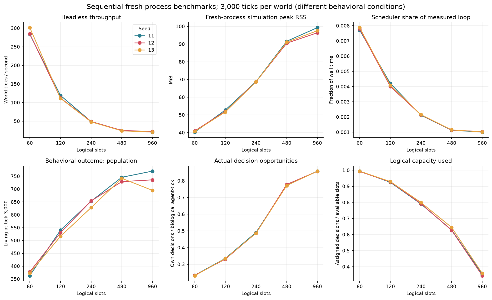
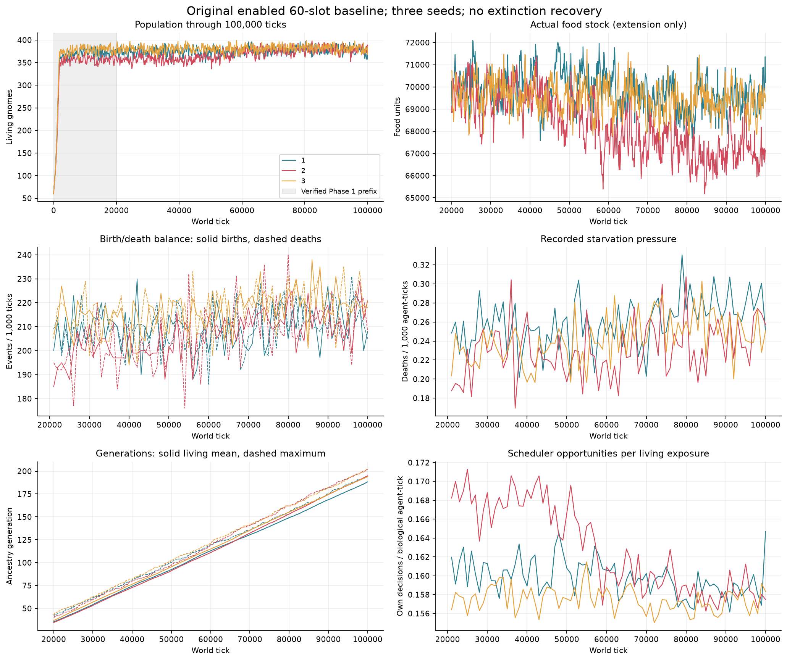

# Gnome Fortress — Phase 2

Completed 19 October 2026. No core decision rules or default capacity have changed.

## Question and controls

The primary question is whether experienced movement associations improve outcomes
under the original 60-slot ecology. Twenty matched seed pairs (1001–1020), each
20,000 ticks, compare original enabled behavior with an experiment-only readout
mask. Both conditions record normal associations/consequences and retain visits,
traits, senses and every other rule. Matching seeds fixes initial conditions, not
future random draw consumption, descendant genotypes or population density.
All scientific worlds begin with 60 distinct founders and receive no interventions.

The primary survival endpoint is the mean of seed-level mean lifespans of ALL
newborns born by tick 17,000. Every such life is complete by the endpoint; founders
and late-born censored lives are separate. The safety endpoint is hazard encounters
per 1,000 executed decisions. Paired seed differences use 10,000 bootstrap resamples
(analysis seed 20261019), with 95% percentile intervals and paired-t sensitivity
intervals. Secondary endpoints are exploratory. Agents and descendants are not
independent statistical replicates.

[Registered protocol](PROTOCOL.md) · [Data definitions and reproduction](DATA_DICTIONARY.md).

## A. Memory findings

**Association readout produced a large survival benefit in this model.** All twenty
enabled worlds survived to tick 20,000 (337–382 living); all twenty ablated worlds
became extinct, at ticks 1,113–6,828. Every registered seed was retained.

| Endpoint (mean across 20 world seeds) | Enabled | Ablated | Enabled minus ablated, paired bootstrap 95% interval |
|---|---:|---:|---:|
| Complete-cohort lifespan, ticks | 1,843.6 | 631.4 | **+1,212.3 [1,120.6, 1,293.3]** |
| Hazard entries / 1,000 decisions | 5.652 | 19.054 | **−13.402 [−14.465, −12.313]** |
| Final living population | 364.6 | 0 | +364.6 [359.3, 369.5] |
| All deaths / 1,000 biological agent-ticks | 0.520 | 1.740 | −1.220 [−1.412, −1.032] |

Lifespan increased **192%** (2.92×); hazard entries per decision fell **70.3%**. Both
primary contrasts favored enabled memory in every pair. Paired-t sensitivity
intervals agree: lifespan +1,117.6 to +1,307.0 ticks; hazard rate −14.583 to −12.220.
These are condition-level effects under the specified rules, not independent
agent-level estimates or general claims about intelligence.

Enabled worlds produced **78,629 offspring**, versus **782** under ablation. Total
deaths were **72,537 versus 1,982**: raw counts reflect vastly different population
exposure and cannot indicate worse survival by themselves. Hazard-death totals were
similar (**1,928 versus 1,952**), despite the enabled worlds supporting many more
lives. The paired raw hazard-death contrast's interval includes zero. Its exposure-
adjusted rate, however, fell from 1.718 to 0.0139 per 1,000 agent-ticks.

Not every endpoint improved. Enabled populations recorded **28,586 starvation
deaths versus zero** under ablation; mean starvation rates were 0.205 versus zero
per 1,000 agent-ticks. Offspring births per agent-time were slightly lower when
enabled (0.564 versus 0.601 /1,000 agent-ticks; paired difference −0.0373,
95% interval −0.0594 to −0.0152). Hazard-dominated early collapse prevents ablated
populations from experiencing the same crowding, age structure and competing risks.
These endpoints do not isolate effects at a fixed population density. Ablated
worlds continued through tick 20,000 after extinction; their faster execution
reflects an empty population and is not a computational optimization.

The descriptive extinction supplement was declared after the first ablated
extinction, without changing primary endpoints or runs. Within-condition exact
binomial 95% reference intervals are **0–16.8%** for enabled and **83.2–100%** for
ablated extinction fractions. These are not paired risk-difference intervals and
avoid equating the observed 0/20 or 20/20 with permanent certainty.
[Addendum](EXTINCTION_ADDENDUM.md) · [Every seed](results/memory-seeds.csv) ·
[Paired effects and intervals](results/memory-effects.csv) ·
[Descriptive lifespan distributions](results/lifespan-distributions.csv).
The distribution file separates completed deaths and censored survivors, and
founders' pre-entry biological ages from observed time in the experiment.

The result establishes benefit from the programmed experience-weighted aversion
component. It does not show that online learning beats an equally strong static
hazard penalty. Visit memory was NOT ablated, later random streams/descendant
traits diverged, and density/scheduling feedback is part of the whole-world effect.
A natural-state one-decision fork and fixed-bias control are the next mechanism tests.

## B. Hardware and scheduler scaling

AMD Ryzen 7 3800X (8 cores/16 logical CPUs), 64 GB RAM, Ubuntu. The GPU/VRAM are
unused. [Environment metadata](ENVIRONMENT.json) records exact runtimes and OS.
Background OS load, CPU frequency and thermals were not forcibly controlled.
These are logical decision budgets inside ONE sequential world, not threads
or model instances. Fifteen sequential fresh-process runs used seeds 11–13 for
3,000 ticks at each requested capacity. Source hashes and exact initial biological
fingerprints were recorded. An additional complete original-engine replay at EVERY
capacity matched its entire final state and history. B ran before A/C to avoid
competition between the measured campaigns.

| Slots | Mean loop seconds / 3,000 ticks | Aggregate ticks/s | Peak loop RSS, MiB | Scheduler share | Final population range | Own decisions / agent-tick |
|---:|---:|---:|---:|---:|---:|---:|
| 60 | 10.36 | 289.6 | 41.0 | 0.779% | 363–378 | 0.233 |
| 120 | 26.29 | 114.1 | 52.8 | 0.410% | 516–540 | 0.334 |
| 240 | 61.45 | 48.8 | 68.8 | 0.214% | 628–654 | 0.488 |
| 480 | 121.96 | 24.6 | 91.6 | 0.114% | 729–746 | 0.774 |
| 960 | 141.95 | 21.1 | 99.3 | 0.102% | 695–770 | 0.858 |

Ticks/s is 9,000 divided by summed loop seconds across three seeds. RSS is the maximum
of three fresh-process simulation high-water marks before export/replay. Loop timing
includes observation counters/sampling; construction, hashing, validation, output and
replays are separate. CPU averaged **99.6–99.8% of one logical CPU**, approximately
6.2% of the 16-logical-CPU machine. Peak process RSS including serialization and
replay was larger: up to **328.4 MiB** in these short benchmarks.

Whole-window capacity utilization was 99.36%, 92.72%, 79.40%, 63.30% and 35.19%,
respectively. At 960 slots, the largest observed population was only 810, so this
campaign did NOT demonstrate sustained execution of 960 live decisions each tick.
Raising capacity increased actual opportunities and changed mortality, reproduction
and the resulting population. These outcomes cannot be treated as equivalent agents
running faster. Above 240, population gains diminished while CPU cost increased.
Three seeds and 3,000 ticks characterize short-run cost/behavior, not long-term
higher-capacity survival or an optimal biological population size.

Behavioral rates below are means of the three world-seed rates, over the same
3,000-tick windows; they describe different opportunity treatments. Birth and
death rates use 1,000 biological agent-ticks; hazard rates use 1,000 own decisions.

| Slots | Mean eligible population | Birth rate | Death rate | Hazard-entry rate |
|---:|---:|---:|---:|---:|
| 60 | 219.8 | 0.711 | 0.305 | 6.177 |
| 120 | 287.2 | 0.845 | 0.376 | 7.451 |
| 240 | 336.1 | 0.982 | 0.482 | 9.316 |
| 480 | 336.9 | 1.111 | 0.534 | 9.836 |
| 960 | 337.8 | 1.128 | 0.558 | 9.846 |

Mean sleep/wake event counts rose from 9,847/9,778 at 60 slots to
15,440/15,319 at 960. Individual seed counts, causes of death and complete
performance records are in [scaling.csv](results/scaling.csv).

Fixed-population scheduler-only tests used 960 or 3,840 identities, including fixed
sleeping/dead fractions, and 10,000 calls per fresh process. Selection cost was about
**68–71 microseconds** for 960 identities and **260–282 microseconds** for 3,840,
with little systematic dependence on returned slot count. This isolates selection
from the larger behavioral workload. [Scheduler-only plot](results/scheduler-only.png).

Profiling preceded any optimization; no optimization was applied. The original
mature 60-slot profile attributed 66% of cumulative time to `_nearby_agents` and
under 1% to scheduling. A separate 960-slot late-window profile attributed about
80% to peer queries. Both scan retained identities; the fast-growing history and
increased decision count matter more than slot selection itself.

A short fresh-world average is not a real-time guarantee. The declared
[late-window supplement](TAIL_BENCHMARK_ADDENDUM.md) times bare original-engine
windows after all campaign workers stopped. In seed 11, the 200-tick windows
starting at tick 3,000 achieved **240.1, 76.0, 26.3, 9.95 and 8.06 ticks/s** at
60/120/240/480/960 slots. These bare-engine late windows differ from the full
instrumented 3,000-tick averages; higher budgets remain more costly.

At tick 100,000, the three original 60-slot worlds achieved **25.13, 24.51 and
23.49 ticks/s** in quiet 200-tick bare-engine windows. Loading, initial digesting
and saving are outside loop timing. Process high-water RSS including loading and
initial verification was about 2 GiB; this is not isolated simulation working-set
RSS. [Every timing case](results/tail-benchmark.csv).

ONE ordinary production save, to a fresh separate file after seed 1's timing
window (tick 100,200), took **18.007 seconds**. Existing-file overwrite latency
and desktop rendering at this age were not measured. The observer saves
synchronously, so adequate loop throughput does not guarantee continuous visual
responsiveness. No save/rendering changes were applied.

## C. Extended survival

All three original enabled 60-slot worlds survived through tick 100,000. The
verified Phase 1 tick-20,000 prefixes for seeds 1–3 were resumed exactly after
digest comparison. New measurements cover ticks 20,001–100,000; complete events
and ancestry cover the entire history. There were no recovery interventions.

Offspring/death totals below cover the full 100,000 ticks. Population ranges are
the exact every-tick extrema in the measured extension, including its initial
tick-20,000 state. Generation counts use founders=0.

| Seed | Final living | Offspring | Deaths | Starvation deaths | Maximum generation | Extension population range |
|---:|---:|---:|---:|---:|---:|---:|
| 1 | 373 | 20,792 | 20,479 | 9,347 | 194 | 346–400 |
| 2 | 387 | 20,369 | 20,042 | 8,125 | 202 | 330–402 |
| 3 | 368 | 21,438 | 21,130 | 8,905 | 202 | 355–404 |

Population showed bounded fluctuations over this observation window, without
extinction or sustained upward growth in the final windows. Mean sampled populations during the last
20,000 ticks were **378.10, 379.71 and 381.93**. Last-window linear slopes were
−0.219, −0.067 and −0.229 gnomes per 1,000 ticks. The previous/final 10,000-tick
means were 378.75/377.44, 381.04/378.54 and 383.25/380.63. These are descriptive
correlated time-series summaries, not proof of stationarity or a periodic cycle.
Independent event reconstruction found final-20,000-tick population ranges of 356–400 (seed 1), 349–402 (seed 2), 362–401 (seed 3).
Finite survival does not establish permanent stability.

Across the three full histories, **62,599 offspring and 61,651 deaths** left
1,128 living descendants. Mean living ancestry generations at the endpoint were
188.3, 194.8 and 194.0, demonstrating extensive turnover rather than founder
immortality. Identity/event archives continued to grow despite the bounded living
population, and headless runtime slowed with world maturity.

Sampled food-stock minima in the extension were 67,583, 65,183 and 67,612 units;
final stocks were 70,200, 67,148 and 69,330. Seed 2's food stock declined visibly
over the window. Starvation persisted at **0.231–0.260 deaths per 1,000 biological
agent-ticks** in the extension despite positive aggregate food stocks. This does
not prove global resource exhaustion or isolate access, location, need dynamics
and decision scarcity. Terminal causes remain the original rule labels.

All three worlds executed exactly **4,800,000 decisions** in the 80,000-tick
extension: 100% of the 60-slot budget. Mean eligible populations were 317.5–328.2,
and own decisions per biological agent-tick were 0.157–0.163. Sleep/wake counts
and sampled rates are preserved, rather than equating occupied final slots with
executed decisions. [Seed summaries](results/endurance.csv) and the per-seed
1,000-tick window CSVs provide the complete rate series.

All six checkpoint checks (ticks 50,000 and 100,000 for every seed) preserved exact
loaded state and matched 32-tick continuations against independent forks, without
advancing the main trajectory. This is segment integrity, not a second complete
100,000-tick replay. Full 20,000-tick memory and per-capacity 3,000-tick replays
provide additional coverage.

## Engineering decisions and verification

For screensaver observation on this Ryzen, recommend **60 active slots**. All
three quiet 100,000-tick samples exceeded the existing 15-tick/s target, but mature
rendering remains unbenchmarked and the measured save can pause the event loop.
Existing speed controls can reduce pacing to 5 ticks/s. Using the existing
`--checkpoint-every 3000` option reduces save frequency, with less frequent
recovery points; it does not shorten individual save pauses. No default changes
were made and uninterrupted desktop responsiveness is not claimed.

For comparable accelerated baseline science, also keep **60 slots** and
parallelize independent seed worlds; raising the budget changes the
experiment rather than accelerating the same process. Six fresh scientific worker
processes were used, not six slots. Their optimal concurrency was not benchmarked.

The complete regression suite passed **52 tests in 243.49 seconds**: original 27,
Phase 1 research six, and Phase 2 nineteen. The original seed-2026 endurance/replay
digest remains unchanged. All **58 final SQLite archives** were independently
reconciled against full birth/death histories, every population/exposure sample,
individual ages, ancestry and counters. Both campaign source-hash manifests
matched. Baseline and Phase 1 tracked files and historical artifacts were checked
unchanged. All eight quiet timing cases completed, and the descriptive lifetime
export accounted for every individual in 232 cohort/status rows.
[Archive checks](results/archive-checks.csv) · [Verification record](results/verification.json) ·
[Validation logs](validation/README.md).

[Defect log](DEFECTS.md): a new telemetry namespace collision between hazard
encounters and hazard deaths failed both pilots' independent reconciliation. It
was documented before correction, fixed before any accepted campaign, and given a
regression test. Failed pilots remain documented. No baseline behavior required a
fix. A later CSV schema defect in the timing supplement was also documented
and corrected before that supplement ran. Configuration sidecars prevent
accidental mixing of non-60 or ablated states.

## Reproducibility and next phase

Preserved rule baseline: `f32c1a612e36b046faa501273640bbabfce5159d`
(`phase0-verified`); Phase 1: `232dd30ce56a4d3645efb3d1dc35cd0539deb497`
(`phase1-verified`); registered controls/runners:
`1e67c3e64bfa8f89bca2a6426b2c013fcae526ef`. The delivered results
commit is tagged `phase2-verified`; resolve its exact ID with
`git rev-parse phase2-verified`. It contains the final analysis/supplements, CSVs,
plots, raw-data archive and checksums. Runtime is Python 3.14.4, SQLite 3.46.1; tested scientific dependencies
are unchanged from `research/requirements-tested.txt`.

Phase 3 should first distinguish acquired information from a stronger fixed bias:
compare the existing readout with a declared static hazard penalty, and fork natural
states for a single decision with identical random state. Keep population-level
survival and decision-level mechanisms separate; use fresh matched world seeds
for confirmation rather than selecting favorable survivors. These are proposed
experiments, not behavior changes made in Phase 2.

For long-running engineering, prototype a sorted active/spatial peer index and
require complete state/event-history equality against the original engine before
adoption. Preserve dead identities and ancestry in storage. Benchmark rendering
and ordinary checkpoint latency on mature states before claiming uninterrupted
screensaver operation. Do not expand decision capacity until the changed
opportunity budget itself is the declared research treatment.

No new behavior, civilization, language system or inference service was added.

The [Word brief](GNOME_FORTRESS_LEAD_BRIEF_INTERIM.docx) is a preserved interim
snapshot requested during the runs, dated 15:28 UTC. This report supersedes its
pending endurance and verification statuses.
