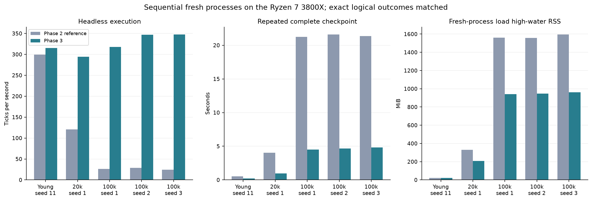

# Phase 3 engineering report

The mission is faster, resumable background operation with Phase 2 biological
behavior preserved. The reference is phase2-verified,
5efc9b1bfdd8d49a13aefd4e9256e6c1e87c024f. Default capacity remains 60 decisions.
No personality, memory, mortality, reproduction, movement scoring, perception or
interaction rule was changed. No information-transmission behavior was introduced.

**Verified engineering result:** mature stepping is 12.1–14.2× faster and
repeated checkpoints are 4.4–4.7× faster, with no detected biological divergence.

## What changed

The engine keeps an insertion-ordered dictionary of living agent references.
Birth inserts a reference, death removes it, and loading reconstructs it. Proximity
queries use the original Manhattan distance and awake filters in original order.
Coordinates are read from the objects, so movement and direct coordinate
interventions cannot leave a stale position cache. Biology and eligibility also
avoid scanning retained corpses. A spatial grid was unnecessary for the measured
population size; peer search remains linear in living population. All identities
and histories remain in the archive.

Saving avoids recursive full-world and duplicate agent copies. It verifies current
agent content, including dead records, and the complete historical event prefix.
Verified unchanged rows remain; matching event history appends only new events.
Untrusted files, changed prefixes or divergent forks trigger full replacement.
All identity rows precede ancestry/memory/relationship rows to preserve efficient
immediate foreign-key checks. One SQLite transaction commits metadata, resources,
records and history together. FULL synchronous durability remains enabled.

The loader streams objects rather than constructing another full nested world,
pins one read transaction, validates sequences and checks new-format integrity.
Header hashes and dimensions are checked before allocation. Old archives remain
readable. A hot journal permits SQLite recovery without creating missing files.
New writes use the same query tables with a mandatory integrity extension; an old
writer must not erase it. This is not automatic repair of storage-device damage.

The observer holds simulation at a complete tick while one writer thread works.
Drawing, inspection, pause, speed and quit events continue. Frozen worlds redraw only on
input/status changes, avoiding writer contention. No biological state is
mutated concurrently. Save wall time creates no catch-up debt. Running frames bound
work between event polls; pacing debt is limited and cleared on speed changes.
Paused observation sleeps and avoids repeated draws. CLI additions are --forever,
--rate, --paused and --stats-every; the automatic checkpoint interval remains
configurable with --checkpoint-every. Shutdown waits for an outstanding checkpoint.

## Profile and experimental method

Before changes, the seed-1 100,000-tick reference profile attributed 88% of profiled
step time to _nearby_agents. Its save profile showed 26.45 cumulative seconds in
recursive dataclass conversion, including 17.57 seconds building a full world
state that the save then largely discarded. Profile instrumentation increases
wall time; those cumulative values overlap and are not unprofiled checkpoint costs.

Accepted timings use five matched starting states, ten sequential fresh processes:
seed 11 from tick zero for 3,000 ticks, seed 1 at tick 20,000 for 200 ticks, and
seeds 1–3 at tick 100,000 for 200 ticks. Order alternates. Saving, hashing, loading
and continuation checks are outside loop timing. First saves create fresh files;
repeated saves follow another 30 ticks. Full logical fingerprints match at four
boundaries. Exact direct field comparisons and original digest checks provide
separate verification. No historical input checkpoint is written.

On the Ryzen 7 3800X (8 cores/16 logical CPUs, 64 GB RAM), mature stepping
improved **12.1–14.2×** and repeated complete checkpoints improved **4.4–4.7×**.
The GPU is unused. A young world has little retained history to skip.

| Start state | Reference ticks/s | Phase 3 ticks/s | Speedup | Repeated save before / after, seconds |
|---|---:|---:|---:|---:|
| Young seed 11 | 299.2 | 315.0 | 1.05× | 0.53 / 0.23 |
| 20k seed 1 | 120.7 | 294.2 | 2.44× | 4.03 / 0.97 |
| 100k seed 1 | 26.2 | 317.7 | 12.13× | 21.24 / 4.52 |
| 100k seed 2 | 28.5 | 347.2 | 12.18× | 21.61 / 4.66 |
| 100k seed 3 | 24.5 | 347.7 | 14.17× | 21.36 / 4.82 |

Fresh 100k saves improved from **18.09–18.98 to 15.54–15.75 seconds**; they
still write the whole initial archive. Subsequent saves improved from
**21.24–21.61 to 4.52–4.82 seconds**. These are fresh-file versus repeated-file
measurements, not interchangeable costs. New 100k files were **154.98–157.80 MiB**,
versus **158.41–161.34 MiB** for the reference. Compact JSON and integrity tables
change physical layout; every logical record is preserved.

Load high-water RSS fell from **1,557–1,596 to 942–962 MiB**, about 40% lower.
Whole-job peaks including two loaded worlds, saves and verification were
2,474–2,532 versus 2,150–2,196 MiB. Neither figure is a steady-state heap estimate.
Headless loops used **98.2–100.0% of one logical CPU**.
[Every timing and CPU/RSS sample](benchmarks.csv) · [Full metrics](benchmark-results.json).

For seed 1's repeated save, the production timers measured:

| Preparation or verification component | Seconds |
|---|---:|
| Agent scalar fields and JSON | 0.464 |
| Ancestry preparation/checksum | 0.065 |
| Recent memories preparation/checksum | 0.726 |
| Relationships preparation/checksum | 0.109 |
| Complete event-prefix serialization/checksum | 2.846 |
| Changed agent SQL | 0.075 |
| New event SQL | 0.002 |

There were 383 changed agent records and 308 new events in that repeated save,
compared with 20,902 identities and 1,121,724 events in the first save. Component
times are scoped in the data dictionary; nested totals must not be added twice.
The post-optimization profile still identifies living-peer queries as 57% of
profiled step time. Repeated saving is now dominated by JSON/checksum work, rather
than rewriting the million-event archive. No further optimization is claimed.

The final real-writer observer trial used SDL dummy rendering, the 100k state and
inspection inputs every 0.2 seconds. During a full save, **92 inputs were serviced**
with maximum observed latency **105 ms**; the whole trial took **18.84 seconds**.
The world fingerprint stayed unchanged. Removing redundant draws of frozen state
reduced the earlier trial's 45.45-second write contention. The final paused
two-second, startup-inclusive trial drew once and used **4.49% of one logical CPU**,
versus 92.34% and 85 draws for the reference. This is not a mature desktop frame-rate
guarantee, or a claim that simulation advances while checkpointing.

The observer refinement followed the headless timings. Its source and harness
hashes are recorded separately in observer-manifest.json; the earlier full
headless inventory remains intact. Engine, model, storage and timed headless
harnesses are byte-unchanged since the accepted measurements. All expected
non-headless differences are listed in historical-verification.json.

## Verification and preserved science

**All 72 tests passed in 199.87 seconds**: the original 52 tests are
byte-unchanged, with 20 focused Phase 3 tests. Coverage includes exact reference
worlds, index maintenance and direct coordinate changes, legacy upgrade,
incremental saves, mutations of dead records, divergent event prefixes, external
file changes, missing/corrupt integrity, truncation and sequence gaps, early header
rejection, forced SIGKILL with page-cache spill, rollback, clean signals, pacing,
statistics, paused sleeping and actual controls serviced while writing.

All five matched timing pairs agree at four complete-state fingerprint boundaries.
Separately, **16 direct mature comparisons** across the 20k snapshot and all three
100k snapshots checked every agent field, memory, RNG state, cell, scheduler and
ordered event at offsets 0,1,50,200. Fresh reference tests cover three seeds through
1,200 ticks. The original 20,100-tick seed-2026 digest remains
`18abcc54608881c6892e1b913cd2b56d6288068afb4515f3467e94cab3c9696e`.

**All 72 published historical SQLite archives loaded and matched their recorded
original digests**, including 50k checkpoints, the 100,200-tick probe and the
experimental capacity/ablation configurations. Published SQLite and bundle bytes
matched their historical hashes. All original tests and research files are
byte-unchanged; Phase 0–2 tags still point to their original commits. The frozen
reference modules match Phase 2 exactly. AST checks confirm the decision, movement,
memory, biology, observation and sensory helper methods are unchanged; model.py
is byte-identical. No biological divergence was detected in accepted comparisons.

[Exact comparisons](equivalence.json) · [Historical and source verification](historical-verification.json) ·
[Regression and diagnostic logs](validation/README.md).

## Defects and remaining limits

The [defect log](DEFECTS.md) preserves implementation failures before correction.
Initial writer/loader mistakes failed focused tests; a real killed-write test found
that read-only opening prevented hot-journal recovery. Header integrity review
found allocation occurred too early. A rejected benchmark found a 93-second fresh
save from deferred foreign-key sweeps; a two-pass writer removed that regression.
No failed trial was accepted as a successful final measurement. Initial sources,
logs and partial outputs remain separate from the accepted campaign.

Historical identity/event growth is still unbounded. Proximity cost no longer grows
with retained corpses, but persistence checks still read complete histories and
rendering still visits retained identities. Saving pauses simulation even though
controls remain available. A single slow tick cannot be preempted midway. Targets
are pacing requests, not guarantees. Corrupt committed storage requires a backup;
SIGKILL recovery preserves the preceding commit, not unsaved ticks. Power-loss or
hardware failure was not physically tested. New checksums detect accidental content
changes, not an attacker rewriting both data and checksums.

Timing runs are small samples on this machine, not confidence intervals or a claim
of indefinite reliability. CPU frequency and desktop background load were not
forcibly controlled. SDL dummy tests do not verify desktop/compositor/GPU behavior.

## Reproduction and next research

[Data definitions and commands](DATA_DICTIONARY.md) describe scopes, file formats,
legacy compatibility and the distinction between streaming and original digests.
The final source/results commit is tagged phase3-verified. Resolve its exact
ID with git rev-parse phase3-verified. Phase 0–2 tags and files remain preserved.

The next research question is whether useful information can be transmitted
between individuals and survive across generations. It requires a separately
declared mechanism and controls; no social learning, morality, language,
invention or civilization system is part of this engineering commit. Keep the
frozen reference and equivalence gates for future changes, and monitor archive
size and checkpoint cost before extending unattended runs far beyond tested ages.

For operation, retain **60 slots**. The default observer pace remains 15 ticks/s;
headless runs can remain unpaced. Choose checkpoint frequency according to the
acceptable recovery window: --checkpoint-every 3000 reduces save overhead but
can lose more unsaved ticks on forced termination than the default 300. Statistics
are emitted to stderr and checkpoint warnings are explicit. No OS service or
external framework was installed. The tested runtime is Python 3.14.4, SQLite
3.46.1 and pygame-ce 2.5.8 on Ubuntu; exact metadata is in ENVIRONMENT.json.
