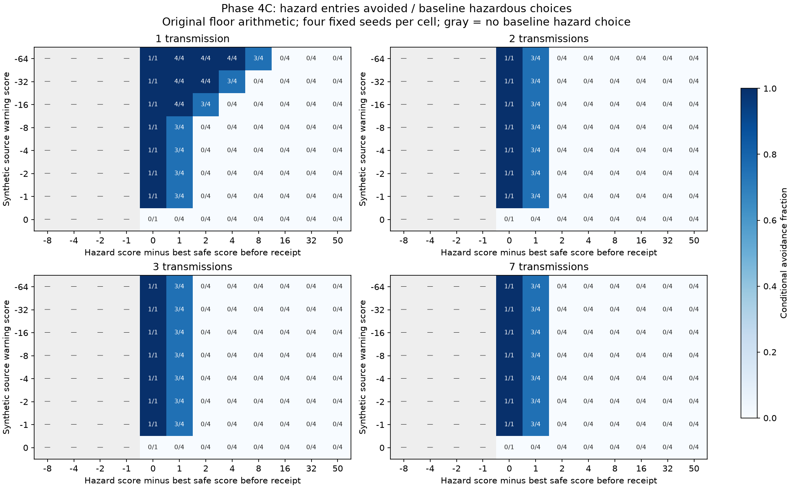

# Phase 4C — Warning strength versus competing preference

2026-10-20. Reference: Phase 4B `2644229a5665a2a8fb6bf60f499fe841b075a29e`;
documentation handoff `be50c49f7f68ce77cdd57d2598d6892f41b06e48`.
Repository: [lokrez/gnome-fortress](https://github.com/lokrez/gnome-fortress).

## Finding

Received information has a causal movement effect, but its strength matters.
All original two-hop warnings reached C at **−1**. Their observed hazard avoidance
came from breaking existing ties. The wider matrix also finds effects across a
one-point preference by **creating a new tie**, but two-hop warnings in the tested
source range cannot overcome larger preferences. Stronger direct warnings can.
The original floor arithmetic creates a persistent minimum negative weight.

Natural forwarding occurred in the small pilot: 27 forwarded deliveries and
three attributable movement changes before firsthand exposure, all in seed 1
and all breaking pre-existing ties. This establishes a narrow natural-opportunity
effect within these worlds; it does not establish survival improvement, reliable
population-wide propagation, cultural inheritance, or intelligence.

**No existing tracked file was modified.** Biology, movement, learning, arithmetic,
scheduler, defaults, checkpoint formats, Observatory and historical evidence remain
unchanged. This phase adds research harnesses, tests and evidence only. No Phase 4D
or endurance campaign was started.

## Protocol and boundaries

[Preregistered protocol](PROTOCOL.md), raw SHA-256
`fb5de4cfd7b892cc9a321d25ad3fe23873661eb5e56b13349a3fb093995e1e3f`,
was written before results. [Measurement notes](MEASUREMENT_NOTES.md) record timing
estimates and the later provenance audit; no outcome-driven fixture adjustment
was made.

The controlled matrix has 27,648 real movement decisions: four fixed seeds,
eight synthetic source scores (−64, −32, −16, −8, −4, −2, −1, 0), four depths
(1, 2, 3, 7), twelve preference margins (−8 through 50 as declared), three
arithmetic methods and six controls. It reuses the actual movement function;
score capture stops that function immediately before its RNG choice. No copied
movement scorer is used. The original 64-seed ablation uses the actual Phase 4B
three-gnome world and its ordinary tick-3 scheduler decision.

For the sensitivity matrix, A first experiences a real hazard. We retain that
real episode/value separately, then explicitly override the source readout with
the declared synthetic strength. Local contacts along an adjacent chain are
prescribed. This isolated research transport mirrors Phase 4B's attenuation and
is checked against real Phase 4B receipts. It is not a new production channel or
a claim that those strengths arose naturally. The matrix advances no biological
ticks and measures no scheduler throughput. The strongest tested source is −64,
not the complete valid range down to −100.

Warnings concern the existing **terrain category** `move:hazard`, not a specific
location. Competing preferences use actual caution and safe-tile visit penalties.
At C, one hazardous and three safe candidates are held fixed. Negative margins
already prefer safety; positive margins prefer the hazard. Irrelevant messages
penalize grass in the harness only. All recipients are hazard-naive before their
measured choice. These are mechanistic interventions, not population samples.

## All 64 original seeds: causal C-only ablation

Every seed delivered A → B → C with C's weight −1 and firsthand count zero.
Original candidates have two safe scores 0 and one hazardous score −1; ablating
only C's movement lookup restores the hazardous candidate to 0. Stored knowledge,
provenance and later learning updates remain intact. Full pre-choice state,
actor state and RNG hashes match between each pair.

| Result | Seeds | Explanation |
|---|---:|---|
| Hazard avoided | 20/64 | Ablated tie selects hazard; received −1 excludes it |
| Safe destination changes | 30/64 | Both choices safe; RNG maps into different tie sets |
| Same safe destination | 14/64 | Ablated choice was already that safe tile |
| Any destination change | 50/64 | Includes the 30 safe-to-safe changes |

Hazard-avoidance seeds: **1, 11, 12, 13, 25, 27, 29, 30, 32, 33, 35, 36, 38, 40, 42, 44, 50, 52, 54, 55**.

Safe-to-safe change seeds: **2, 3, 4, 5, 6, 7, 8, 9, 10, 14, 17, 18, 19, 20, 21, 22, 24, 26, 31, 41, 43, 46, 47, 48, 49, 53, 58, 60, 61, 64**.

Unchanged seeds: **15, 16, 23, 28, 34, 37, 39, 45, 51, 56, 57, 59, 62, 63**.

Thus the earlier 20/64 is reproduced as hazard avoidance, not confused with
50/64 destination changes. Every unchanged seed received applicable information;
its coupled choice simply remained safe. Per-seed scores, chosen coordinates,
reasons and boundary hashes are in [matched-seeds.csv](results/matched-seeds.csv).
[Original provenance](results/original-provenance.json) preserves every actual
source proof. [Both branches](results/ablations.csv) include final state digests.

## Strength versus preference

Let D be the hazardous score minus the best safe score before receipt and w the
received negative weight. The original scorer gives a new margin **D + w**.
Below zero, safety wins; at zero, a tie remains; above zero, the hazard wins.
Already-safe choices need not change for delivery to have succeeded.

The table pools negative source scores, all four depths and four fixed seeds
under original arithmetic: 112 trials per margin. These sample fractions are
not estimates of natural-world frequencies.

| Initial margin D | Changed maximizers | Baseline hazardous choices | Hazards avoided | Any destination change |
|---:|---:|---:|---:|---:|
| −8, −4, −2, −1 (each) | 0/112 | 0/112 | 0 | 0 |
| 0 | 112/112 | 28/112 | 28/28 | 84/112 |
| 1 | 112/112 | 112/112 | 87/112 | 87/112 |
| 2 | 12/112 | 112/112 | 11/112 | 11/112 |
| 4 | 8/112 | 112/112 | 7/112 | 7/112 |
| 8 | 4/112 | 112/112 | 3/112 | 3/112 |
| 16, 32, 50 (each) | 0/112 | 112/112 | 0 | 0 |

At depth one, source −64 becomes −8: it strictly reverses margins 1, 2 and 4,
and creates a tie at 8. At depths two, three and seven, every negative source in
this matrix becomes −1. Those forwarded warnings affect only D=0 or D=1; they
never reverse a strict preference by more than one point here. All D=1 changes
from that −1 result from the newly created tie, not a strict safe preference.



## Controls and attenuation

Each row below has **1,536 target decisions** (4 seeds × 8 strengths × 4 depths ×
12 margins). “Applicable” means received content changes an actual candidate
score, not merely that a packet arrives. “Rank” means the maximizing set changes.
Every row has 928 baseline hazardous choices. Direct-only reaches C only at depth
one. Zero-strength sources are intentionally included and cannot send useful
warnings; opaque masked tokens can still travel.

| Arithmetic / condition | Target delivered | Applicable | Rank changed | Destination changed | Hazards avoided / increased |
|---|---:|---:|---:|---:|---:|
| Floor / individual | 0 | 0 | 0 | 0 | 0 / 0 |
| Floor / direct-only | 336 | 336 | 80 | 66 | 52 / 0 |
| Floor / multihop | 1,344 | 1,344 | 248 | 192 | 136 / 0 |
| Floor / masked | 1,536 opaque | 0 | 0 | 0 | 0 / 0 |
| Floor / irrelevant | 1,344 | 1,344 | 248 | 192 | 0 / 136 |
| Floor / C-only ablation | 1,344 | 0 | 0 | 0 | 0 / 0 |
| Truncate / multihop | 576 | 240 | 64 | 54 | 44 / 0 |
| Symmetric / multihop | 672 | 336 | 80 | 66 | 52 / 0 |

For floor multihop: delivery is 1,344/1,536 (87.5%); score applicability is
1,344/1,344 delivered; decision change is 192/1,344 applicable (14.3%). Hazard
avoidance is 136/928 baseline hazardous choices overall, or 136/812 when restricted
to those with a delivered warning. The other 56 changed destinations are safe-to-safe.
The complete eighteen-condition table is [conditions.csv](results/conditions.csv).
Wrong-category information can increase hazard entries: content matters, and
communication is not intrinsically beneficial.

With a new recipient whose previous score is zero, original attenuation is
`floor(floor(s/2)/4) = floor(s/8)`. Negative −1 maps to −1 forever mathematically,
while +1 maps to 0. The actual mechanism stops after seven receipts and blocks
loops/duplicates; this is a numerical persistence floor, not increasing confidence
or independent corroboration. Zero and positive values are ineligible warnings.
The signed arithmetic table includes them only as diagnostics.

| Source | Floor depths 1,2,3,7 | Truncate depths 1,2,3,7 | Symmetric depths 1,2,3,7 |
|---:|---|---|---|
| −64 | −8, −1, −1, −1 | −8, −1, 0, 0 | −8, −1, 0, 0 |
| −32 | −4, −1, −1, −1 | −4, 0, 0, 0 | −4, −1, 0, 0 |
| −4 | −1, −1, −1, −1 | 0, 0, 0, 0 | −1, 0, 0, 0 |
| −1 | −1, −1, −1, −1 | 0, 0, 0, 0 | 0, 0, 0, 0 |
| +1 (math only) | 0, 0, 0, 0 | 0, 0, 0, 0 | 0, 0, 0, 0 |

Truncation is toward zero. Symmetric rounding is nearest with ties away from
zero, separately at /2 and /4; both are sign-symmetric, unlike floor. Deliveries
that acquire zero count as deliveries but not behavioral effects; zero can stop
subsequent forwarding. Against floor, changing only arithmetic changes 138/1,536
multihop destinations (92 hazard/safe outcomes) for truncation and 126/1,536
(84 hazard/safe outcomes) for symmetric rounding. Matching RNG and unrelated
state are checked for every comparison. No arithmetic was replaced in the engine.
The full valid-range diagnostic includes −100, which reaches −2 at two floor
hops: do not extrapolate the matrix's −1 result to every possible source strength.

## Unscripted natural-opportunity pilot

Seeds 1,2,3, **300 ticks**, ordinary maps, agents and existing social decisions;
60 founders and 60 scheduler slots. No meetings were arranged. “Opportunity” is
a realized awake/local channel request, not a census of all possible nearby pairs.
All attempts here were physically eligible. Conditions diverge after meaningful
information changes decisions; their later meetings and RNG streams are not paired
causal trajectories. Each readout comparison instead couples RNG at its own actual
movement boundary.

| Condition | Local opportunities / attempts | Direct / forwarded deliveries | Clean applicable moves | Changed decisions / hazard avoidance |
|---|---:|---:|---:|---:|
| Individual | 1,771 | 0 / 0 | — | — |
| Direct-only | 1,781 | 94 / 0 | 501 | 8 / 8 |
| Multihop | 1,793 | 82 / 27 | 643 | 11 / 11 |
| Masked | 1,771 | 88 / 18 opaque | no useful content | no useful readout effect |

In multihop worlds, 109 recipients acquired information. 106 encountered at least
one clean hazard/safe movement opportunity; three did not. Across 4,968 clean
post-receipt moves, 643 had relevant terrain; 18 maximizing sets changed and eleven
actual choices changed (ten recipients). Forwarded recipients contributed 178
applicable moves and **3/178** immediate choice changes, in three recipients.
This ratio is descriptive and repeated decisions are not independent samples.
All three occurred in seed 1; seeds 2 and 3 each delivered nine forwarded warnings
but had no forwarded-attributable choice changes in this window.

The three forwarded examples, with legitimate source histories and zero firsthand
exposure at receipt and decision:

- 43 → 57 → 13 → 60: source −27 at tick 5; receipts at ticks 7,16,52 give −4,−1,−1.
  Agent 60 avoids a tied hazardous choice at tick 102.
- 43 → 57 → 13: the same grounded source; agent 13 avoids a tied hazard at tick 194.
- 68 → 12 → 74: source −13 at tick 64; receipts at 88,166 give −2,−1.
  Agent 74 avoids a tied hazard at tick 264.

[Structured natural evidence](results/natural-evidence.json) includes complete
bounded receipt chains, actual/counterfactual candidates and RNG hashes. These
roots had no prior social input. Other pilot roots sometimes did: 19/109 multihop
receipts trace to firsthand roots marked `prior_social`, so “direct” does not
always mean an independent discovery. Of the eight direct-receipt-attributed
changes in multihop worlds, seven strictly reverse a non-tied preference and one
creates a tie. This contrasts with the three tie-breaking forwarded effects.

At the end, 26/109 recipients had not personally experienced the hazard, 96 had
lost their bounded hear episode, and **zero** had lost the association key.
Episode eviction therefore does not imply forgetting the weight. Eighty-three
recipients eventually mixed social and firsthand updates; **6,491 mixed moves
were excluded** from readout attribution. These categories overlap. The existing
single EMA value cannot be cleanly separated after mixing: removing it would
remove firsthand learning too. The pilot does not identify that mixed causal share.

## Verification, costs and limitations

- Initial focused checks: **38 passed** before campaign execution.
- Fast regression suite: **141 passed in 140.74 s**. Three additional checks were
  then added; final focused suite: **41 passed in 5.10 s**. Together these cover
  all **144 distinct current fast tests**. No prolonged test/archive campaign ran.
- Exact replay: **128 ablation branches**, **27,648 matrix rows**, **4,221 arithmetic
  rows**, all **12 pilot world/metric replays**. All twelve instrumented worlds
  exactly match uninstrumented Phase 4B state, including RNG and stored history.
- Tests cover score signs/zero/rounding, original tie ordering, conflicting
  preferences, pure/nonmutating score inspection, legitimate source receipts,
  mixed-origin rejection, no-candidate behavior, bounded pilot diagnostics, and
  existing provenance/death/loop/persistence regressions.
- Every pre-existing tracked file remains Git-clean against the handoff; all ten
  Phase 4B package files are byte-identical to reference. Existing CSV checkout
  line endings follow the existing Git attributes and were preserved. No verified defect
  was fixed or unexplained behavioral divergence accepted.

On the Ryzen 7 3800X (Python 3.14.4), the full campaign took **30.22 s wall**, 99%
of one CPU, **36.8 MiB peak RSS**. Full replay took 43.4 s. A separate paired
300-tick multihop process benchmark across seeds 1–3 averaged **1.201 s** without
the observer versus **1.428 s** with it (**18.9% overhead**). Peak process RSS was
23.9 MiB versus 28.8–29.0 MiB; serialized auxiliary diagnostics occupied
18.9–22.9 KB/world. These process peaks include interpreter/import overhead;
that RSS difference is not an exact allocation measurement. This is a small
single-run benchmark per seed, not a hardware capacity estimate. CSV gzip is
streamed; no per-tick history was added. Observer storage is aggregate counters,
one usage record per recipient identity and at most eight examples per world;
it is not a fixed memory cap for an indefinitely growing population.

The main limitations are the engineered score geometry, four fixed matrix seeds,
synthetic strengths, three short pilot worlds, one shared RNG, and indivisible
mixed EMA values. Long-term consequences are untested. The score is an association
weight, not a calibrated confidence probability. The evidence supports a causal
information-transfer mechanism whose forwarded behavioral effect is heavily
tie-sensitive, with an arithmetic persistence floor. It does not justify stronger
claims about adaptive value or culture.

## Reproduce

From the repository root, using the existing environment:

```bash
.venv/bin/python -m research.phase4c_demo --seed 1 --source -64 --depth 2 --margin 1
.venv/bin/python -m research.phase4c_study --output run-results/phase4c-new
.venv/bin/python -m research.phase4c_verify run-results/phase4c-new
.venv/bin/python -m research.phase4c_evidence run-results/phase4c-new
.venv/bin/python -m research.phase4c_analyze run-results/phase4c-new --plot
.venv/bin/python -m research.phase4c_benchmark > run-results/phase4c-new/overhead.json
.venv/bin/python -m pytest -q tests/test_phase4c.py tests/test_telephone.py
.venv/bin/python -m pytest -q tests research/test_analysis.py research/test_phase2.py research/test_study.py --ignore=tests/test_long_run.py
```

The default demonstration deliberately retains the declared seed-1, depth-2,
margin-1 cell: C still chooses the hazard because its newly created tie happens
to select it. Run `--seed 2` at that same cell to see a changed choice, or
`--depth 1` for the stronger direct warning. These are presentation examples
from the fixed matrix, not retuned fixtures. `--json` includes full rows.

The study refuses an existing output directory. Plotting alone needs matplotlib
and NumPy; the study, demonstration and replay use the standard library plus
the existing project. Timing and image bytes are excluded from deterministic
scientific comparisons. [Demo capture](demo-capture.txt) shows the actual three
readouts. Primary CSV/JSON, derived tables, proofs, logs and the heatmap are
retained here. The code is research-only and not part of the default launcher. Score probes
inspect Python call frames and deliberately bind to the verified `World.move`
call site; they would need review if that function changed.
Find the study commit with `git log -1 --format=%H -- research/phase4c/REPORT.md`;
its full hash is also supplied in the completion message.

Recommended next decision: agree on the intended attenuation semantics before
any separately authorized follow-up. Preserve this floor reference for comparison;
if a later phase tests alternative arithmetic in natural worlds, predeclare it
and keep useful-delivery, applicable-choice and survival endpoints separate.
No follow-up experiment is started by this recommendation.
